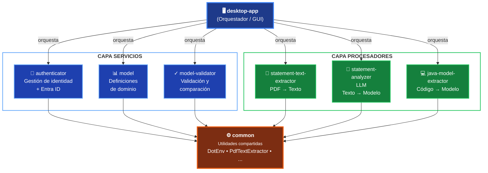
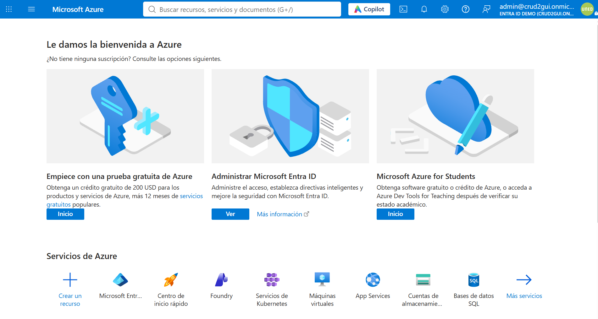
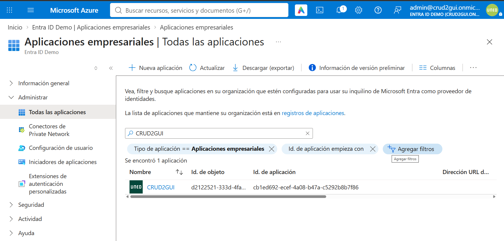
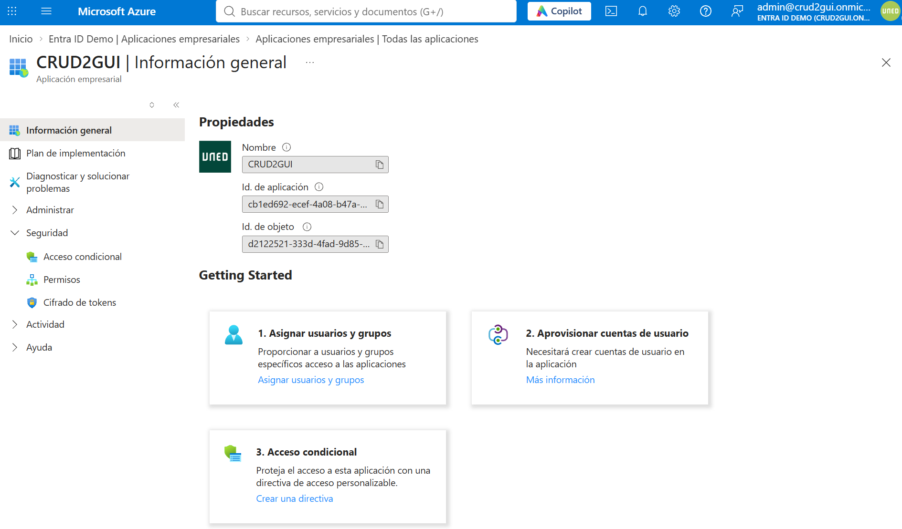
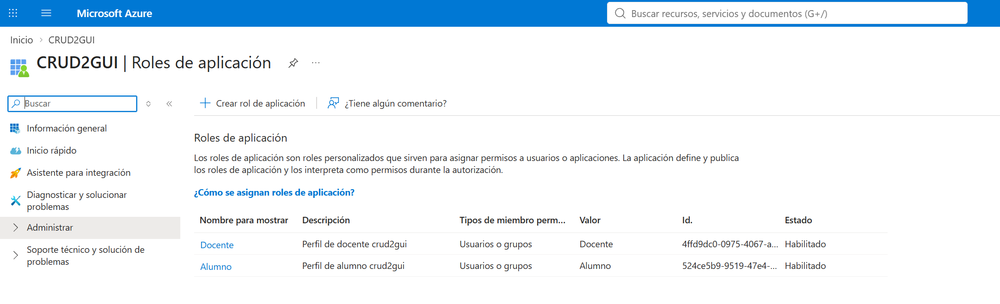
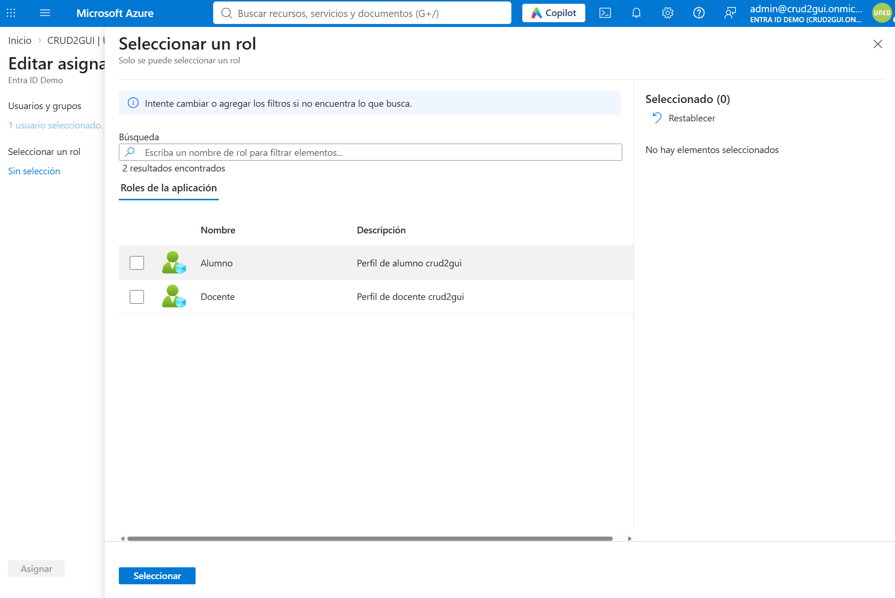
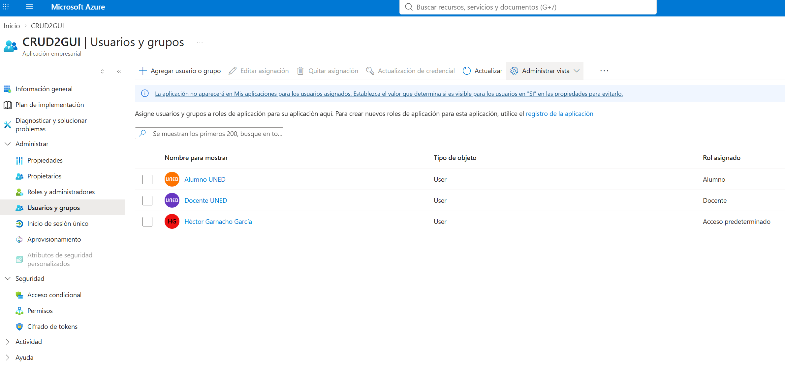

# CRUD2GUI

## Memoria del Trabajo Fin de Grado

**Universidad Nacional de Educación a Distancia**

Generación automática de interfaces gráficas para apoyar el aprendizaje de la programación orientada a objetos.

| Datos académicos | Información |
| --- | --- |
| Autor | Pendiente de completar |
| Titulación | Pendiente de completar |
| Tutor/a | Pendiente de completar |
| Curso académico y convocatoria | Pendiente de completar |
| Estado | Borrador inicial |

## Resumen

*Pendiente: sintetizar el problema, los objetivos, la solución desarrollada y los resultados obtenidos.*

**Palabras clave:** CRUD2GUI; programación orientada a objetos; Java; JavaFX; generación de interfaces.

## Abstract

*Pending: English version of the final summary.*

## Índice provisional

- [1. Introducción](#1-introducción)
- [2. Objetivos y alcance](#2-objetivos-y-alcance)
- [3. Estado del arte](#3-estado-del-arte)
- [4. Metodología y planificación](#4-metodología-y-planificación)
- [5. Análisis de requisitos](#5-análisis-de-requisitos)
- [6. Diseño y arquitectura](#6-diseño-y-arquitectura)
- [7. Implementación](#7-implementación)
- [8. Pruebas y evaluación](#8-pruebas-y-evaluación)
- [9. Distribución y uso](#9-distribución-y-uso)
- [10. Conclusiones y trabajo futuro](#10-conclusiones-y-trabajo-futuro)
- [Bibliografía](#bibliografía)
- [Anexos](#anexos)

*Estructura provisional: adaptar a la normativa y a las indicaciones de tutorización.*

## 1. Introducción

### 1.1. Contexto y motivación

CRUD2GUI es una aplicación desarrollada para apoyar a estudiantes y docentes de la Universidad Nacional de Educación a Distancia (UNED) que cursan la asignatura **FUNDAMENTOS DE INFORMÁTICA** (I.MECÁNICA / I.TECNOLOGÍAS INDUSTRIALES / I.ENERGÍA 68901097).

La motivación principal radica en proporcionar una herramienta que facilite tanto la docencia como el aprendizaje de la programación orientada a objetos (OOP) mediante:

- **Validación automática** de las prácticas obligatorias de la asignatura.
- **Simulación interactiva** de las soluciones desarrolladas por los alumnos.
- **Generación automática de interfaces gráficas** basadas en modelos de clases, eliminando la complejidad de la construcción manual de GUIs y permitiendo que los estudiantes se concentren en la lógica orientada a objetos.
- **Análisis inteligente** de código fuente usando tecnología de LLM (Large Language Models) para detectar desviaciones respecto a los requisitos del enunciado.

### 1.2. Planteamiento del problema

La enseñanza de la programación orientada a objetos presenta varios desafíos en entornos de educación a distancia:

1. **Falta de retroalimentación inmediata:** Los estudiantes envían sus soluciones, pero la evaluación manual de modelos de clases requiere tiempo significativo de los docentes.

2. **Dificultad en validar modelos conceptuales:** Es complejo para los estudiantes entender si su diseño orientado a objetos responde adecuadamente a los requisitos especificados en el enunciado de la práctica.

3. **Interacción limitada con los modelos:** Aunque los estudiantes escriben código, carecen de un mecanismo intuitivo para interactuar con sus objetos en tiempo de ejecución (crear, modificar, consultar, eliminar).

4. **Sobrecarga docente en validación:** Los docentes deben revisar manualmente cada envío, extraer clases de código fuente, compilarlas y probar que se ajusten a los requisitos.

CRUD2GUI aborda estos problemas proporcionando:
- Extracción automática de modelos desde enunciados (mediante LLM) y desde código Java.
- Comparación estructurada entre el modelo esperado y el implementado.
- Interfaz CRUD generada automáticamente para interactuar con instancias de clases reales.
- Automatización del ciclo validación-prueba-retroalimentación.

### 1.3. Estructura de la memoria

*Pendiente de desarrollar.*

## 2. Objetivos y alcance

### 2.1. Objetivo general

Desarrollar una aplicación de apoyo educativo que automatice la validación, simulación y prueba de las prácticas obligatorias de programación orientada a objetos en la asignatura FUNDAMENTOS DE INFORMÁTICA de la UNED, mediante la generación automática de interfaces gráficas CRUD y el análisis inteligente de modelos de clases.

### 2.2. Objetivos específicos

#### Para docentes:

- Inferir automáticamente, mediante un LLM, un modelo de clases que represente una solución al problema planteado en el enunciado de la práctica.

- Seleccionar el código fuente Java de la solución de un alumno y obtener de él un modelo de clases que pueda compararse con el modelo inferido desde el enunciado.

- Validar automáticamente el modelo extraído del código del alumno comparándolo con el modelo inferido desde el enunciado, para determinar si cumple los requisitos estructurales de la práctica. El resultado debe indicar si el modelo es válido y detallar las divergencias detectadas.

- Cuando el modelo de la solución del alumno sea válido, generar una interfaz gráfica de usuario con operaciones CRUD sobre las clases Java analizadas. El docente podrá utilizarla para probar la solución y comprobar su comportamiento.

#### Para estudiantes:

- Cargar el código fuente Java de su solución para obtener automáticamente el modelo de clases correspondiente.

- Validar ese modelo comparándolo con el modelo de referencia inferido desde el enunciado en el perfil docente y proporcionado por el profesor. El resultado debe indicar si cumple los requisitos estructurales y, si no los cumple, informar de las divergencias detectadas.

- Cuando el modelo de la solución sea válido, obtener una interfaz gráfica de usuario con operaciones CRUD sobre las clases Java de su solución, para probarla e interactuar con sus objetos sin tener que desarrollar una interfaz manualmente.

### 2.3. Alcance y limitaciones

#### Alcance

CRUD2GUI se plantea como una aplicación de escritorio de apoyo a docentes y estudiantes de **Fundamentos de Informática** de la UNED (68901097). Está orientada a las prácticas obligatorias de programación orientada a objetos de la asignatura, no al análisis general de cualquier proyecto Java ni a la generación de aplicaciones web.

El flujo comprende la extracción del texto de un enunciado en PDF y su análisis mediante un modelo de lenguaje (LLM) accesible por API para proponer un modelo de clases de referencia. Por otra vía, la aplicación analiza estáticamente los archivos fuente Java de la solución para obtener un modelo con sus tipos, atributos, métodos y relaciones. La comparación de ambos modelos permite comprobar los requisitos estructurales de la etapa evaluada e informar de las divergencias detectadas. En el perfil de estudiante, la referencia para esa comparación la proporciona el docente, tal como se describe en el apartado 2.2.

El proyecto prevé generar una interfaz gráfica CRUD a partir del modelo extraído de una solución válida, una vez resueltas las confirmaciones que puedan quedar pendientes, como la selección de la clase gestora. La interfaz se utilizará para probar la solución con instancias reales de sus clases: crear objetos mediante los constructores disponibles, identificarlos y consultar su estado, modificar los atributos que admitan cambios y simular su eliminación.

#### Restricciones y limitaciones

- **Formato y organización de las prácticas.** El análisis del enunciado requiere un PDF con texto extraíble; no incluye reconocimiento óptico de caracteres (OCR). Se parte de prácticas organizadas en etapas incrementales: cada etapa amplía la anterior y la parte opcional se entiende como una extensión de la obligatoria. Por tanto, la solución debe compararse con una referencia que corresponda a la etapa y a la parte que se quiere evaluar.
- **Identificadores y fragmentos de código.** Se espera que el enunciado y sus ejemplos mantengan una nomenclatura coherente. Los nombres, las firmas y los tipos exigidos deben respetarse, incluidas las mayúsculas y minúsculas cuando corresponda. Una solución puede ser conceptualmente equivalente y, aun así, no superar la validación si cambia un identificador obligatorio. Las inconsistencias del propio enunciado pueden dar lugar a avisos, pero no se garantiza que el análisis las detecte todas.
- **Patrón de clase gestora.** Las prácticas contempladas incluyen una clase que coordina o administra otras clases u objetos. Su detección en el código se basa en indicios y puede requerir confirmación. Las clases lanzadoras, aunque se puedan reconocer durante la extracción, no se prevén como elementos del dominio sobre los que se generará la interfaz. El modelo puede representar distintos tipos de relaciones y multiplicidades, así como interfaces, enumeraciones y clases abstractas; poder representar un tipo no implica que la interfaz pueda crear instancias de él. En particular, el diseño previsto no ofrecerá la creación directa de instancias de clases abstractas ni de clases que solo declaren un constructor privado sin parámetros. Este último criterio es una heurística del proyecto para reconocer posibles *singleton*, no una prueba de que exista una única instancia.
- **Validez estructural y comportamiento.** La calidad del modelo inferido depende de la claridad del enunciado y de la respuesta del LLM. La comparación comprueba la estructura descrita en los modelos, pero no demuestra que los métodos se comporten correctamente ni sustituye las pruebas funcionales o la evaluación docente.
- **Simulación sin persistencia.** El CRUD previsto trabajará con objetos en memoria, sin guardarlos en una base de datos ni conservar su estado entre ejecuciones. La operación de eliminación será lógica: marcará el objeto como eliminado en la simulación, sin destruirlo de inmediato. El recolector de basura de Java podrá recuperar su memoria cuando el objeto deje de ser alcanzable.

## 3. Estado del arte

### 3.1. Herramientas de apoyo al aprendizaje de la orientación a objetos

Entre las herramientas relacionadas con la evaluación de prácticas de programación orientada a objetos destaca [**OOPGrader**](https://github.com/oopgrader/oopgrader), un proyecto académico de código abierto para evaluar programas Java a partir de un modelo de solución definido por el docente. El docente proporciona los programas, el modelo esperado y, cuando se evalúa el comportamiento, una batería de pruebas JUnit. La herramienta analiza el modelo y el código, calcula una calificación configurable y produce comentarios detallados por entrega; también genera un fichero de notas que puede importarse en un sistema de gestión del aprendizaje como Moodle. Su complemento para Eclipse contempla tanto el uso docente como la validación del modelo por parte del estudiante [1].

OOPGrader constituye una referencia especialmente próxima a CRUD2GUI en cuanto a la comparación de soluciones y la retroalimentación educativa. Ambos plantean ayudar al docente a revisar diseños orientados a objetos y ofrecer al estudiante información sobre su solución. La diferencia principal está en el origen y uso del modelo esperado: OOPGrader parte de un modelo preparado previamente por el docente y añade evaluación basada en pruebas; CRUD2GUI plantea inferir el modelo desde el enunciado y facilitar la exploración interactiva de las clases mediante una interfaz generada.

### 3.2. Análisis de código y generación de interfaces

También existen herramientas de modelado que cubren partes del proceso. [**Visual Paradigm**](https://www.visual-paradigm.com/features/ai-uml-class-diagram-chatbot/) ofrece un chatbot de IA que genera diagramas UML de clases editables a partir de descripciones en lenguaje natural. El usuario puede revisar y refinar el resultado y utilizar el ecosistema de Visual Paradigm para documentar el modelo; en la edición de escritorio también se pueden generar esqueletos de código y realizar ingeniería inversa desde código fuente [2]. Se parece a CRUD2GUI en que puede convertir una descripción textual en una representación de clases y trabajar con código. Se diferencia en que su finalidad es el modelado general: las funciones descritas no comparan automáticamente la solución de un alumno con los requisitos de una práctica ni generan una GUI CRUD para probarla.

[**StarUML**](https://docs.staruml.io/user-guide/language-support/) proporciona funciones de generación de código y de ingeniería inversa para diversos lenguajes, entre ellos Java. En el flujo inverso se selecciona una carpeta de fuentes para crear elementos de modelo UML y, según las opciones, diagramas de estructura; en el flujo de generación se parte de un modelo UML para producir archivos fuente [3]. Se parece a CRUD2GUI en el paso de obtener una estructura de clases a partir de Java. No infiere el modelo a partir del enunciado, no evalúa entregas ni ofrece la interfaz CRUD interactiva planteada por el proyecto.

En el ámbito de las interfaces, [**JavaFX CRUD Generator**](https://github.com/saulhidalgoaular/javafx-crud-generator) es un proyecto de código abierto que genera un panel CRUD para una clase proporcionada junto con un proveedor de datos. Su documentación contempla datos en memoria y la integración con proveedores basados en tecnologías como JPA, Hibernate o MyBatis [4]. Se parece a CRUD2GUI en la generación de una interfaz para crear, consultar, modificar y eliminar instancias. Su alcance es más acotado: parte de una clase ya disponible y no incluye el análisis del enunciado, la extracción y validación del modelo ni los flujos diferenciados de docente y estudiante.

### 3.3. Comparativa y aportación del proyecto

La tabla resume las capacidades relevantes y hace explícitos los puntos de contacto y las diferencias respecto a [CRUD2GUI](https://github.com/hgarnacho/tfg-crud2gui). La comparación es funcional y se basa en la documentación consultada; no pretende equiparar la madurez, el propósito ni el grado de implementación de los productos.

| Herramienta | Funcionalidad principal | Similitudes con CRUD2GUI | Diferencias respecto a CRUD2GUI |
| --- | --- | --- | --- |
| [OOPGrader](https://github.com/oopgrader/oopgrader) | Evalúa programas Java contra un modelo de solución docente; puede ejecutar pruebas JUnit y genera notas y feedback detallado. | Comparte el contexto educativo con CRUD2GUI, la comparación de diseños de los alumnos y la generación de retroalimentación. | Requiere que el docente prepare el modelo esperado; está orientado a calificar diseño y comportamiento, no a inferir el modelo desde el enunciado ni a generar una GUI CRUD. |
| [Visual Paradigm](https://www.visual-paradigm.com/features/ai-uml-class-diagram-chatbot/) | Genera diagramas de clases editables inferidos desde lenguaje natural y permite trabajar con modelos y código mediante sus herramientas de escritorio. | Puede partir de una descripción textual, producir un modelo de clases y conectarlo con código fuente. | Es una herramienta general de modelado; no realiza el flujo de validación de prácticas, no permite validar o comparar modelos ni genera un interfaz CRUD interactivo que permita interactar con objetos de las clases definidas en el modelo. |
| [StarUML](https://docs.staruml.io/user-guide/language-support/) | Genera código desde modelos UML y crea modelos a partir de código fuente, incluido Java. | Comparte la ingeniería inversa de Java y la representación de clases. | No obtiene el modelo esperado desde un enunciado ni evalúa entregas; tampoco genera una interfaz CRUD para que el alumno interactúe con su solución. Solo genera las firmas de lós metodos CRUD, pero no implementa su lógica. Se utiliza principalmente para modelar aplicaciones Java. |
| [JavaFX CRUD Generator](https://github.com/saulhidalgoaular/javafx-crud-generator) | Genera paneles CRUD para una clase y un proveedor de datos. | Comparte la generación de interfaz para operar sobre instancias de clases. | Parte de una clase ya definida; no analiza enunciados ni código para validar modelos, y no incorpora el flujo educativo de docente y estudiante. Requiere persistencia, y necesita un JPA como Hibernate o MyBatis.|
| [CRUD2GUI](https://github.com/hgarnacho/tfg-crud2gui) | Integra el análisis del enunciado, la extracción del modelo Java, su comparación y la generación de una GUI en un contexto educativo. | — | Su propuesta se distingue por integrar capacidades que las herramientas consultadas ofrecen por separado o con objetivos diferentes. Permite interactuar sobre objetos reales de las clases del modelo en memoria, sin persistencia.|

En conclusión, sí existen alternativas y referencias cercanas a las funciones de CRUD2GUI. OOPGrader es especialmente relevante para la corrección de programas y la retroalimentación, mientras que StarUML y Visual Paradigm ofrecen capacidades de modelado e ingeniería inversa. La posible diferenciación de CRUD2GUI está en integrar capacidades que estas herramientas cubren por separado en un flujo dirigido a prácticas de programación orientada a objetos: partir del enunciado, obtener y validar el modelo de la solución y facilitar la interacción con ella mediante una interfaz generada. Esta integración busca conectar el análisis de requisitos con la validación y la experimentación práctica del estudiante.

Esta conclusión se limita a las herramientas y documentación consultadas y no pretende demostrar que no exista ninguna otra solución con funcionalidades similares. Asimismo, la tabla describe el alcance funcional de CRUD2GUI; el grado de implementación y validación de cada capacidad debe documentarse en los capítulos de implementación y pruebas.

## 4. Metodología y planificación

### 4.1. Proceso de desarrollo

*Pendiente de desarrollar.*

### 4.2. Planificación e hitos

*Pendiente de desarrollar.*

### 4.3. Seguimiento y gestión de riesgos

*Pendiente de desarrollar.*

## 5. Análisis de requisitos

### 5.1. Perfiles de usuario y casos de uso

CRUD2GUI define dos perfiles de usuario diferenciados, cada uno con objetivos, necesidades y flujos de trabajo específicos. Ambos perfiles interactúan con la misma aplicación, pero con distintos puntos de entrada y funcionalidades priorizadas.

#### 5.1.1. Perfil 1: Docente

**Descripción del perfil:**
El docente es un miembro del equipo académico de la asignatura FUNDAMENTOS DE INFORMÁTICA que diseña prácticas obligatorias, establece criterios de validación y evalúa las soluciones aportadas por estudiantes.

**Características:**
- Responsable de diseñar enunciados de práctica que especifiquen modelos de clases esperados.
- Define los patrones y características comunes que deben seguir los enunciados (estructura, vocabulario, formato).
- Necesita herramientas para validar que las soluciones estudiantiles se ajusten a los requisitos planteados.
- Busca automatizar el proceso de evaluación para reducir tiempo de revisión manual.

**Objetivos funcionales del docente:**

1. **Generar una referencia de solución modelo:**
   - Cargar un enunciado de práctica en PDF.
   - Usar CRUD2GUI para extraer automáticamente el modelo esperado (clases, atributos, métodos) mediante LLM.
   - Obtener una representación estructurada del modelo conceptual que el estudiante debe implementar.
   - Usar la GUI generada para validar interactivamente que el modelo inferido es correcto.

2. **Crear una GUI de referencia para los estudiantes:**
   - Proporcionar a los estudiantes una interfaz CRUD generada automáticamente basada en el modelo del enunciado.
   - Permitir que los estudiantes interactúen con ejemplos de uso sin implementar la GUI ellos mismos.
   - Facilitar la comprensión de cómo deben comportarse sus objetos en tiempo de ejecución.

3. **Validar soluciones estudiantiles:**
   - Cargar el código fuente Java aportado por un estudiante.
   - Comparar automáticamente el modelo extraído del código contra el modelo inferido del enunciado.
   - Recibir un reporte detallado de divergencias (clases faltantes, atributos adicionales, tipos incompatibles, etc.).
   - Evaluar la conformidad sin necesidad de revisión manual línea por línea del código.

4. **Generar retroalimentación estructurada:**
   - Usar los reportes de validación para proporcionar retroalimentación clara y específica a estudiantes.
   - Señalar exactamente qué elementos del modelo no coinciden con los requisitos.
   - Permitir que los estudiantes comprendan dónde corregir sus implementaciones.

**Casos de uso del docente:**

| Caso de Uso | Descripción | Requisitos Funcionales |
|---|---|---|
| **CU-D1: Preparar práctica desde enunciado** | El docente carga un PDF con el enunciado de una práctica y genera el modelo esperado. | RF-1 (inferir modelo desde PDF con LLM) |
| **CU-D2: Validar modelo inferido** | El docente interactúa con la GUI generada para verificar que el modelo extraído es correcto. | RF-4 (interfaz CRUD) |
| **CU-D3: Compartir GUI referencia** | El docente proporciona a estudiantes la GUI generada como herramienta de validación. | RF-4 (interfaz CRUD) |
| **CU-D4: Evaluar solución estudiantil** | El docente carga código Java de un estudiante y compara su modelo contra el esperado. | RF-2 (extraer modelo de código) + RF-3 (validar modelos) |
| **CU-D5: Revisar reporte de validación** | El docente analiza el reporte de divergencias para evaluar conformidad de la solución. | RF-3 (generar reporte) |

---

#### 5.1.2. Perfil 2: Estudiante

**Descripción del perfil:**
El estudiante es un alumno de la asignatura FUNDAMENTOS DE INFORMÁTICA que debe desarrollar soluciones de programación orientada a objetos siguiendo especificaciones de prácticas obligatorias.

**Características:**
- Debe implementar modelos de clases que satisfagan los requisitos del enunciado de la práctica.
- Busca validar que su solución es correcta antes de entregarla.
- Necesita interactuar con sus objetos en tiempo de ejecución para probar comportamientos.
- Carece de experiencia en desarrollo de interfaces gráficas y necesita enfocarse en la lógica OOP.

**Objetivos funcionales del estudiante:**

1. **Cargar y validar su código:**
   - Proporcionar a CRUD2GUI las clases Java que ha desarrollado.
   - Recibir un análisis automático que indique si su modelo satisface los requisitos.
   - Obtener un reporte de errores o divergencias para identificar qué corregir.

2. **Probar su solución de forma interactiva:**
   - Generar una GUI automáticamente desde sus clases sin necesidad de programar interfaz.
   - Interactuar con instancias reales de sus objetos mediante la interfaz CRUD.
   - Crear objetos, consultar sus estados, modificar atributos y eliminar objetos.

3. **Entender desviaciones de requisitos:**
   - Recibir retroalimentación clara sobre qué elementos de su modelo no coinciden con lo esperado.
   - Comprender exactamente cuáles son los atributos faltantes, métodos incorrectos o tipos de datos incompatibles.
   - Saber cómo corregir su implementación.

4. **Comparar su solución contra una referencia:**
   - Acceder a una GUI generada por el docente basada en el modelo esperado (si el docente la proporciona).
   - Interactuar con la referencia para comprender el comportamiento esperado.
   - Usar esa referencia como patrón para validar que su propia solución es equivalente.

**Casos de uso del estudiante:**

| Caso de Uso | Descripción | Requisitos Funcionales |
|---|---|---|
| **CU-E1: Cargar código para validación** | El estudiante proporciona sus clases Java a CRUD2GUI para análisis. | RF-2 (extraer modelo de código) |
| **CU-E2: Revisar reporte de validación** | El estudiante lee el reporte de divergencias para identificar errores en su modelo. | RF-3 (generar reporte) |
| **CU-E3: Generar GUI de prueba** | El estudiante genera automáticamente una interfaz CRUD desde sus clases. | RF-4 (interfaz CRUD) |
| **CU-E4: Interactuar con sus objetos** | El estudiante usa la GUI para crear objetos, consultar, modificar y eliminar instancias. | RF-4 (CRUD operations) |
| **CU-E5: Comparar contra referencia** | El estudiante compara la GUI de su solución con la GUI de referencia proporcionada por docente. | RF-4 (interfaz CRUD) |
| **CU-E6: Iterar y mejorar** | El estudiante corrige su código, recarga en CRUD2GUI y valida nuevamente. | RF-2, RF-3 (ciclo iterativo) |

---

#### 5.1.3. Flujos de trabajo integrados

**Flujo de trabajo del docente (preparación de práctica):**

```
1. Docente carga enunciado PDF
   ↓
2. CRUD2GUI extrae modelo esperado (RF-1: LLM)
   ↓
3. Docente valida modelo en GUI generada (RF-4: CRUD)
   ↓
4. Docente ajusta modelo si es necesario
   ↓
5. Docente proporciona GUI referencia a estudiantes
   ↓
6. Estudiantes descargan GUI referencia
```

**Flujo de trabajo del estudiante (desarrollo y validación):**

```
1. Estudiante desarrolla clases Java
   ↓
2. Estudiante carga código en CRUD2GUI
   ↓
3. CRUD2GUI extrae modelo del código (RF-2: análisis estático)
   ↓
4. CRUD2GUI valida contra modelo esperado (RF-3: comparación)
   ↓
5. Estudiante recibe reporte de divergencias
   ↓
6. Estudiante genera GUI CRUD de prueba (RF-4: interfaz)
   ↓
7. Estudiante interactúa con sus objetos
   ↓
8. Estudiante compara con GUI referencia del docente
   ↓
9. Si hay divergencias: corrige código → vuelve a paso 2
   Si es correcto: entrega solución
```

**Flujo de evaluación del docente (revisión de soluciones):**

```
1. Docente recibe código estudiantil
   ↓
2. Docente carga código en CRUD2GUI
   ↓
3. CRUD2GUI extrae modelo del código (RF-2)
   ↓
4. CRUD2GUI compara contra modelo esperado (RF-3)
   ↓
5. Docente recibe reporte automático de conformidad
   ↓
6. Docente proporciona retroalimentación basada en reporte
   ↓
7. Decisión: Aprobado / Requiere correcciones
```

---

#### 5.1.4. Matriz de funcionalidades por perfil

| Funcionalidad | Docente | Estudiante | Prioridad |
|---|:---:|:---:|---|
| Inferir modelo desde enunciado PDF (RF-1) | ✅ Sí | ❌ No | Alta |
| Extraer modelo desde código Java (RF-2) | ✅ Sí | ✅ Sí | Alta |
| Validar modelos y generar reportes (RF-3) | ✅ Sí | ✅ Sí | Alta |
| Generar interfaz CRUD (RF-4) | ✅ Sí | ✅ Sí | Alta |
| Comparar GUIs referencia y solución (RF-4 + análisis) | Implícita | ✅ Sí | Media |
| Autenticación y gestión de sesiones | ✅ Sí | ✅ Sí | Alta |
| Gestión de proyectos/envíos | ✅ Sí | ✅ Sí | Media |
| Generación de reportes detallados | ✅ Sí | ✅ Sí | Alta |

### 5.2. Requisitos funcionales

CRUD2GUI implementa cuatro funcionalidades nucleares que conforman el flujo de trabajo principal:

#### RF-1: Inferir un Modelo de Clases Válido a partir de un Enunciado con LLM

**Descripción:** Partiendo de un enunciado de práctica obligatoria en formato PDF que sigue patrones y características comunes establecidas por el equipo docente, la aplicación:

1. Extrae el texto del documento PDF y lo convierte a texto plano estructurado.
2. Aplica un proceso de optimización que elimina información redundante o no relevante para el modelo.
3. Envía una petición a un servicio LLM (Large Language Model) con un prompt estructurado.
4. Recibe y parsea una respuesta en formato JSON estructurado que representa un modelo válido para la resolución del problema.

**Entrada:** Archivo PDF con enunciado de práctica.  
**Salida:** Instancia de modelo estructurado (Statement con sus Transactions asociadas).

#### RF-2: Obtener un Modelo partiendo de Código Fuente Java

**Descripción:** La aplicación admite como entrada un conjunto de clases Java que resuelven el problema planteado en el enunciado. Mediante análisis estático del código fuente:

1. Parsea ficheros `.java` o `.class`.
2. Extrae definiciones de clases, atributos, métodos, tipos de datos y anotaciones.
3. Mapea los elementos extraídos a instancias del modelo de dominio (clases `Statement`, `Transaction`, etc.).
4. Genera un modelo estructurado equivalente que puede compararse con el modelo inferido del enunciado.

**Entrada:** Código fuente Java (.java files o .class compilados).  
**Salida:** Instancia de modelo extraída de las definiciones de clases.

#### RF-3: Validar el Modelo del Código Fuente contra un Modelo Válido del Enunciado

**Descripción:** La aplicación permite contrastar dos modelos y determinar la conformidad entre:

1. El modelo extraído del código fuente Java aportado como solución.
2. El modelo válido inferido del enunciado de la práctica.

La validación genera un reporte detallado que incluye:
- Divergencias estructurales (clases faltantes, atributos adicionales, tipos incompatibles).
- Conformidad con patrones esperados.
- Recomendaciones para correcciones.

**Entrada:** Dos instancias de modelo (Statement).  
**Salida:** Reporte de validación con divergencias e indicadores de conformidad.

#### RF-4: Construir una Interfaz CRUD en función de un Modelo Válido

**Patrón de las prácticas:** En las prácticas obligatorias de programación orientada a objetos que aborda CRUD2GUI se repite una forma de organizar las responsabilidades: una **clase gestora** actúa como nexo del modelo de dominio. Coordina los objetos de otras clases y puede mantener referencias o colecciones de ellos. Por ejemplo, en una práctica sobre una biblioteca, una clase `Biblioteca` podría administrar los libros y coordinar sus préstamos. Este papel no debe confundirse con el de una **clase lanzadora**, cuyo método `main` sirve para iniciar o probar una etapa de la práctica, no para gestionar los objetos del dominio.

La generación de la interfaz tomará la gestora identificada como punto de partida para organizar la interacción con los objetos de la solución. El generador dispondrá también de las clases y sus relaciones para determinar sobre qué objetos ofrecer las operaciones CRUD. Las clases lanzadoras no serán objeto de esas operaciones. La representación de la gestora se describe en el apartado 6.3.1 y su detección en el apartado 7.2.

**Descripción:** Basándose en un modelo validado, la aplicación genera automáticamente una interfaz gráfica interactiva (CRUD — Create, Read, Update, Delete) que permite:

1. **Creación (Create):** Instanciar objetos reales de las clases existentes en el modelo, utilizando cualquiera de los constructores disponibles.
   - Interfaz dinámica que adapta campos según el constructor seleccionado.
   - Validación de tipos de entrada.

2. **Consulta (Read):** Consultar todos los objetos instanciados en un momento dado.
   - Listado de objetos con identificador único y estado actual.
   - Vista detallada de propiedades de cada objeto.

3. **Modificación (Update):** Establecer el valor de los atributos de cada uno de los objetos instanciados.
   - Interfaz para edición de propiedades.
   - Validación de tipos y restricciones de negocio.

4. **Eliminación (Delete):** Simular la destrucción de los objetos previamente instanciados.
   - Confirmación de operación.
   - Actualización automática de referencias si aplica.

**Entrada:** Modelo de clases (`ProjectModel`) extraído del código Java y validado, sin confirmaciones pendientes para el CRUD.  
**Salida:** Interfaz gráfica JavaFX funcionalmente completa para interacción CRUD.

### 5.3. Requisitos no funcionales

*Pendiente de desarrollar.*

## 6. Diseño y arquitectura

### 6.1. Arquitectura general

*Pendiente de desarrollar.*

### 6.2. Organización en módulos Maven

CRUD2GUI está organizado como un proyecto Maven multi-módulo que separa responsabilidades en componentes independientes reutilizables. La estructura refleja la arquitectura funcional del sistema y facilita pruebas, mantenimiento y evolución.

#### 6.2.1. Módulos componentes

**1. `common` — Utilidades compartidas**
- **Funcionalidad:** Clases y métodos reutilizables independientes de dominios específicos.
- **Dependencias:** Ninguno de los otros módulos.
- **Contenido típico:** Gestión de variables de entorno (`DotEnv`), utilidades de conversión, manejo de excepciones.
- **Entrada:** Código cliente que necesita utilidades.
- **Salida:** Funciones auxiliares, configuración centralizada.

**2. `authenticator` — Autenticación e identidad**
- **Funcionalidad:** Gestiona la autenticación con Microsoft Entra ID mediante MSAL4J.
- **Dependencias:** `common`.
- **Responsabilidad:** 
  - Comunicación con Entra ID.
  - Obtención y gestión de tokens de acceso.
  - Transformación de identidad de Entra ID en objetos de dominio (`AuthenticatedUser`).
  - No depende de JavaFX; comunicación con la GUI mediante callbacks/acciones.
- **Entrada:** Solicitudes de inicio/cierre de sesión, URLs de autorización a presentar.
- **Salida:** Objeto `AuthenticatedUser` con identidad y roles, tokens de acceso.

**3. `model` — Definición del modelo de datos**
- **Funcionalidad:** Define las clases del modelo de dominio (`Statement`, `Transaction`, etc.).
- **Dependencias:** `common`.
- **Responsabilidad:** 
  - Especificar estructura de datos y validaciones básicas.
  - Facilitar interoperabilidad entre extractores, analizadores y validadores.
- **Entrada:** Ninguna (definición estática).
- **Salida:** Clases modelo que otros módulos consumen.

**4. `statement-text-extractor` — Extracción de texto de PDF**
- **Funcionalidad:** Extrae texto legible de documentos PDF de extractos bancarios.
- **Dependencias:** `common`, `model`.
- **Responsabilidad:** 
  - Parsear ficheros PDF.
  - Extraer y normalizar texto de transacciones.
  - Retornar texto estructurado listo para análisis.
- **Entrada:** Ruta a fichero PDF, configuración de filtrado (variable `FILTER_STATEMENT_TEXT`).
- **Salida:** Texto de transacciones normalizado.

**5. `statement-analyzer` — Análisis con LLM**
- **Funcionalidad:** Transforma texto de transacciones en instancias del modelo usando un LLM (Gemini, Groq o similar).
- **Dependencias:** `common`, `model`.
- **Responsabilidad:** 
  - Invocar API de LLM con prompts específicos.
  - Parsear respuesta JSON retornada.
  - Mapear campos a instancias de `Statement`.
  - Gestión de reintentos y errores.
- **Entrada:** Texto de transacciones, configuración de LLM (clave API, endpoint, modelo).
- **Salida:** Instancias de `Statement` pobladas.

**6. `java-model-extractor` — Extracción desde código Java**
- **Funcionalidad:** Genera instancias del modelo desde definiciones de clases Java mediante análisis estático.
- **Dependencias:** `common`, `model`.
- **Responsabilidad:** 
  - Parsear ficheros `.java` o `.class`.
  - Extraer atributos, tipos, anotaciones.
  - Mapear a estructuras de `Statement`/`Transaction`.
- **Entrada:** Ruta a código Java o ficheros compilados.
- **Salida:** Instancias de `Statement` extraídas del código.

**7. `model-validator` — Validación y comparación**
- **Funcionalidad:** Compara dos modelos y genera un reporte de diferencias.
- **Dependencias:** `common`, `model`.
- **Responsabilidad:** 
  - Comparar estructura y contenido de dos modelos.
  - Generar reporte detallado de divergencias.
  - Validar coherencia del modelo.
- **Entrada:** Dos instancias de `Statement` o modelos.
- **Salida:** Reporte de validación con divergencias identificadas.

**8. `desktop-app` — Interfaz gráfica con JavaFX**
- **Funcionalidad:** Orquesta el flujo de trabajo de usuario mediante paneles interactivos.
- **Dependencias:** `common`, `authenticator`, `model`, `statement-text-extractor`, `statement-analyzer`, `java-model-extractor`, `model-validator`.
- **Responsabilidad:** 
  - Presentar interfaz gráfica con JavaFX.
  - Gestionar flujo de autenticación y autorización.
  - Invocar módulos extractores/analizadores en respuesta a acciones del usuario.
  - Presentar resultados, errores y estado de operaciones.
  - Gestionar contexto de trabajo persistente del usuario.
- **Entrada:** Acciones del usuario (clic, entrada de formulario, selección de fichero).
- **Salida:** Interfaz actualizada, ficheros generados, reportes de validación.

#### 6.2.2. Topología de dependencias



**Características de la arquitectura:**

| Aspecto | Descripción |
|---------|-------------|
| ✅ **Sin ciclos** | Dependencias directas hacia capas inferiores |
| 📦 **Independencia** | Extractores/analizadores reutilizables |
| 🎯 **Orquestación clara** | `desktop-app` coordina todas las capas |
| 🔧 **Base estable** | `common` proporciona servicios transversales |
| 📈 **Separación visual** | Capas Servicios y Procesadores bien diferenciadas |

#### 6.2.3. Flujos entrada-salida por módulo

| Módulo | Entrada | Salida | Dependencias |
|--------|---------|--------|--------------|
| `common` | — | Utilidades, configuración | — |
| `authenticator` | Solicitud sesión, URL callback | `AuthenticatedUser`, tokens | `common` |
| `model` | — | Clases modelo (`Statement`, `Transaction`) | `common` |
| `statement-text-extractor` | Ruta PDF | Texto transacciones normalizado | `common`, `model` |
| `statement-analyzer` | Texto transacciones | Instancias `Statement` | `common`, `model` |
| `java-model-extractor` | Ruta código Java | Instancias `Statement` | `common`, `model` |
| `model-validator` | 2× instancias modelo | Reporte diferencias | `common`, `model` |
| `desktop-app` | Acciones usuario | UI actualizada, ficheros | Todos menos sí mismo |

### 6.3. Modelo de datos y flujos de información

#### 6.3.1. Entidades principales

El modelo de dominio en CRUD2GUI opera en dos niveles:

**Nivel 1: `Statement` (Enunciado como texto)**
- **Concepto:** Representa el enunciado de una práctica como un **texto narrativo**. Es la especificación en lenguaje natural de lo que el estudiante debe implementar, extraída de un PDF o documento.

- **Atributos:** 
  - Texto completo del enunciado (párrafos con requisitos)
  - Origen (ruta del PDF)
  - Metadatos de filtrado (secciones incluidas/excluidas)
  - Fecha de procesamiento

- **Responsabilidad:** Almacenar el enunciado en forma legible antes de pasarlo al analizador LLM. Facilita la comparación entre la especificación textual y la implementación.

---

**Nivel 2: `ProjectModel` (Modelo de clases estructurado en JSON)**

`ProjectModel` es la representación común del modelo de clases, tanto si se infiere del enunciado con un LLM como si se extrae de los fuentes Java. Su formato de intercambio se define en [project-model-v1.schema.json](../modules/model/src/main/resources/com/crud2gui/model/project-model-v1.schema.json), un recurso del módulo `model` escrito según la especificación **JSON Schema Draft 7**. Este contrato permite que el analizador, el extractor, el visor y el comparador trabajen con la misma estructura aunque los datos procedan de procesos distintos.

**Ejemplo mínimo conforme al esquema (sin tipos ni relaciones):**

```json
{
  "schemaVersion": "1.0",
  "expectedManagerId": null,
  "source": {
    "root": null,
    "generatedAt": null,
    "filesParsed": 0,
    "warnings": []
  },
  "types": [],
  "relations": [],
  "analysis": null,
  "layout": null
}
```

**Componentes de `ProjectModel`:**

| Componente | Responsabilidad |
|------------|-----------------|
| **schemaVersion** | Identifica la versión del formato. Este esquema solo acepta la cadena `"1.0"`. |
| **types[]** | Declaraciones de clases, interfaces, enumeraciones, `record` y tipos de anotación. Incluye sus miembros, su visibilidad y, si están disponibles, el Javadoc y la ubicación en el código. |
| **relations[]** | Relaciones de herencia, realización, composición, agregación, asociación o dependencia. Cada vínculo identifica el origen y el destino y registra la confianza, así como la multiplicidad y la evidencia cuando están disponibles. |
| **expectedManagerId** | Identificador simple de la clase gestora designada en el enunciado; `null` si no se puede establecer una designación explícita e inequívoca. |
| **analysis** | Resultados del análisis del código: gestora seleccionada, candidatas alternativas, posibles subgestoras y puntos de entrada. Puede ser `null`. |
| **source** | Metadatos de procedencia: ruta de origen y fecha de generación cuando están disponibles, número de ficheros y avisos. |
| **layout** | Posiciones `(x, y)` asociadas a los tipos para distribuirlos en el diagrama. Puede ser `null`; no forma parte de la estructura de clases que se compara. |

**Reglas del formato.** Las siete claves de la raíz deben estar presentes, aunque algunas admitan `null`. El esquema rechaza claves no declaradas en la raíz y en los objetos de estructura fija. También restringe valores como la visibilidad (`PUBLIC`, `PROTECTED`, `PACKAGE` o `PRIVATE`) y la confianza (`HIGH`, `MEDIUM` o `LOW`). Las definiciones reutilizables evitan describir el mismo dato varias veces: por ejemplo, `TypeRef` se emplea en atributos, parámetros y retornos, y admite argumentos genéricos anidados y dimensiones de arrays. Así, `List<Libro>` conserva por separado el tipo de la colección y la referencia a `Libro`.

**Uso y alcance de la validación.** En el flujo docente de inferencia, la aplicación incorpora el esquema al *prompt* para indicar al LLM qué formato debe devolver. Al recibir la respuesta, `ProjectModelSchema` comprueba el JSON antes de que `ModelIO` lo convierta en un objeto Java. Esta comprobación detecta errores de formato, pero no determina si el modelo satisface el enunciado. Por ejemplo, el esquema exige que `from` y `to` sean cadenas no vacías, pero no comprueba que esos identificadores aparezcan en `types`. De igual modo, el ejemplo vacío anterior cumple el esquema, pero eso no lo convierte en una solución válida para una práctica. La comparación con el modelo de referencia es responsabilidad de `model-validator` (véase el apartado 7.4).

**Representación de la clase gestora.** La gestora se representa como un tipo de `types`, con sus atributos, métodos y relaciones. Lo que cambia según el origen del modelo es cómo se señala ese papel:

- **Modelo inferido del enunciado:** `expectedManagerId` referencia el identificador de la clase a la que el texto atribuye explícitamente la coordinación. El LLM no debe asignar este papel solo por el nombre de una clase. Si la designación es ambigua, el identificador queda en `null` y se registra un aviso.
- **Modelo extraído del código:** `analysis.managerClass` guarda el identificador Java de la clase seleccionada (`id`, cualificado con el paquete cuando existe), su puntuación (`score`), su nivel de confianza (`confidence`) y los motivos (`reasons`). `analysis.alternatives` recoge las demás candidatas; `subManagers` identifica posibles gestoras subordinadas, `entryPoints` registra las clases con `main` y `manualOverride` indica si la elección se fijó manualmente.

Esta separación permite distinguir la gestora **esperada** según el enunciado de la gestora **detectada** en la solución Java. El visor de diagramas resalta la clase identificada y la usa como referencia para organizar el diagrama.

---

**Flujo de transformación:**

```
  PDF / Documento
      ↓
  StatementExtractor (extrae texto)
      ↓
  Statement (texto narrativo del enunciado)
      ↓
  StatementAnalyzer (invoca LLM)
      ↓
  LLM genera JSON con estructura de clases
      ↓
  ProjectModel (JSON validado contra schema)
      ↓
  Desktop-app: presenta en interfaz gráfica y diagrama
```

---

**Comparación de modelos:**

Cuando se cargan dos modelos (ej: desde PDF y desde código Java), el `model-validator` los compara a nivel de `types`, `fields`, `methods` y `relations`, generando un reporte de divergencias.

#### 6.3.2. Flujos de información por caso de uso

**Flujo 1: Cargar desde PDF (extracto bancario)**

```
Usuario selecciona PDF
        ↓
desktop-app → statement-text-extractor
        ↓
Extrae texto de transacciones
        ↓
desktop-app → statement-analyzer (LLM)
        ↓
Genera instancias Statement/Transaction
        ↓
desktop-app almacena en contexto
        ↓
GUI presenta extrato con transacciones visuales
```

**Flujo 2: Cargar desde código Java**

```
Usuario selecciona archivo .java o .class
        ↓
desktop-app → java-model-extractor
        ↓
Parsea estructura de clases/atributos
        ↓
Genera instancias Statement (atributos como Transactions)
        ↓
desktop-app almacena en contexto
        ↓
GUI presenta modelo extraído
```

**Flujo 3: Validar/Comparar modelos**

```
Usuario solicita validación
        ↓
desktop-app carga modelos en contexto (ej: PDF + código)
        ↓
desktop-app → model-validator
        ↓
Compara estructura y contenido
        ↓
Genera reporte de divergencias
        ↓
GUI presenta reporte visual
```

#### 6.3.3. Ciclo de vida de datos en sesión

1. **Autenticación:** Usuario inicia sesión → `authenticator` obtiene `AuthenticatedUser`
2. **Contexto de trabajo:** `desktop-app` crea/recupera contexto persistente del usuario
3. **Cargas:** Usuario aporta recursos (PDF, código) → módulos extractores generan modelos
4. **Transformación:** Analizadores (LLM o estáticos) generan instancias del modelo
5. **Persistencia:** Modelos se almacenan en contexto (fichero JSON o caché)
6. **Comparación:** Validador compara modelos cargados
7. **Visualización:** GUI presenta resultados
8. **Cierre:** Contexto se persiste; sesión se cierra

#### 6.3.4. Serialización y persistencia

- **Formato:** JSON (utilizado por `statement-analyzer` al parsear respuesta de LLM)
- **Almacenamiento:** Contexto de trabajo se persiste en fichero local (ruta configurable)
- **Secretos:** No se almacenan tokens ni credenciales en contexto persistente
- **Acceso:** Solo el usuario autenticado puede acceder a su contexto (identificación por `AuthenticatedUser`)

### 6.4. Diseño de la interfaz

*Pendiente de desarrollar.*

### 6.5. Diseño del sistema de autenticación

#### 6.5.1. Proveedor de identidad y separación de responsabilidades

CRUD2GUI utiliza Microsoft Entra ID como proveedor externo de identidad. La autenticación se integra mediante Microsoft Authentication Library for Java (MSAL4J), que permite ejecutar el flujo de acceso sin implementar un servicio propio de contraseñas. Esta elección permite delegar la identificación de los usuarios en una plataforma especializada y utilizar los roles de aplicación para diferenciar los perfiles de alumno y docente.

La solución distingue entre **autenticación**, que establece la identidad del usuario, y **autorización**, que determina las funcionalidades a las que puede acceder. La obtención de una identidad no implica por sí sola el acceso a un panel: la aplicación comprueba los roles recibidos antes de seleccionar el área de trabajo.

El módulo Maven `authenticator` encapsula la configuración, la comunicación con Entra ID y la obtención de la identidad. No depende directamente de JavaFX. El módulo `desktop-app` presenta el acceso, comunica los estados de espera y error y decide qué panel mostrar. La presentación de la URL de autorización se proporciona al autenticador mediante una acción, de modo que el servicio no necesita conocer los controles gráficos utilizados.

#### 6.5.2. Flujo de acceso para un cliente público de escritorio

La aplicación se configura como un **cliente público**, ya que un ejecutable distribuido a los usuarios no puede custodiar de forma confidencial un secreto de cliente. Por este motivo, el acceso no utiliza un `client secret` ni requiere almacenar contraseñas de usuario en los ficheros de configuración de CRUD2GUI.

El flujo interactivo utiliza un código de autorización con PKCE (*Proof Key for Code Exchange*), gestionado por MSAL4J, y los ámbitos de identidad de OpenID Connect. PKCE vincula el código de autorización con la solicitud que lo originó, reduciendo el riesgo de que un código interceptado pueda canjearse desde otro cliente. El retorno se realiza mediante una dirección HTTP de loopback, cuyo valor predeterminado es `http://localhost`; este callback pertenece al equipo local y no es un servidor remoto de CRUD2GUI.

La secuencia de acceso es la siguiente:

1. El usuario solicita iniciar sesión desde la pantalla de acceso.
2. El autenticador inicia la operación interactiva y entrega la URL de autorización a la interfaz.
3. Según `AZURE_AUTH_BROWSER`, la aplicación presenta la página de Microsoft en un `WebView` JavaFX integrado (`webview`) o la abre en el navegador predeterminado del sistema (`system`). Las credenciales se introducen en la página de Microsoft, no en un formulario propio de CRUD2GUI.
4. Tras la interacción con el proveedor, el flujo retorna al callback local y MSAL4J completa la adquisición de tokens.
5. El autenticador transforma los datos de identidad del ID token en un objeto `AuthenticatedUser`, que contiene la identidad y los roles, sin entregar el token a los paneles.
6. La aplicación comprueba el perfil y abre el panel correspondiente o, si existe un contexto de trabajo guardado, permite conservarlo o reiniciarlo antes de continuar.

La ejecución es asíncrona para mantener operativa la interfaz mientras se realiza el acceso. Los resultados se trasladan al hilo de JavaFX antes de modificar los controles.

#### 6.5.3. Perfiles de acceso y sesión

Los perfiles se representan mediante los roles de aplicación `alumno` y `docente`. Su definición y asignación corresponden a la configuración de Entra ID; no se deducen del nombre ni de la dirección de correo del usuario. Si una cuenta dispone de ambos roles, la implementación actual prioriza el panel docente. Una cuenta sin ninguno de los roles reconocidos no da lugar a la apertura de estos paneles.

La identidad permite asociar el contexto de trabajo al usuario autenticado. Este contexto conserva referencias a los ficheros utilizados en las distintas etapas y debe distinguirse de la sesión de autenticación y de la caché de tokens. Mantener un contexto guardado no sustituye un nuevo inicio de sesión.

El cierre de sesión contempla dos operaciones: retirar las cuentas de la caché MSAL en memoria y solicitar el cierre de la sesión web en Microsoft. Si no se puede confirmar el cierre remoto, la aplicación vuelve a la pantalla de acceso y presenta una advertencia, sin afirmar que la sesión de Microsoft haya finalizado correctamente.

#### 6.5.4. Alcance y limitaciones de seguridad

La presentación del navegador durante el acceso se realiza en dos modos configurable (ver sección 7.6.3.1):

- **Modo `webview`**: Integra la página de Microsoft en una ventana embebida dentro de CRUD2GUI. Ofrece una experiencia unificada pero puede tener limitaciones con características de seguridad avanzadas (SSO, MFA, acceso condicional) dependiendo de las capacidades del `WebView` en el entorno de ejecución.

- **Modo `system`**: Abre la página de Microsoft en el navegador predeterminado del sistema operativo. Ofrece mejor compatibilidad con SSO, MFA y políticas de acceso condicional, pero requiere que el usuario cambie de aplicación y no permite confirmar remotamente que el cierre de sesión en Microsoft se completó.

El modo se selecciona con `AZURE_AUTH_BROWSER` (`webview` o `system`) y, si no se configura, se usa `webview`. Ambos modos deben validarse con las políticas del tenant de despliegue antes de usar CRUD2GUI en un entorno institucional.

La selección del panel por roles se realiza en el cliente de escritorio. No debe interpretarse como una autorización independiente aplicada por un servidor. Si se incorporan servicios remotos protegidos, estos deberán verificar los tokens y los permisos correspondientes en su propia frontera de acceso.

#### 6.5.5. Posible integración con la identidad institucional de la UNED

Durante el uso de una cuenta institucional de la UNED se ha observado el acceso al portal de cuenta de Microsoft, `myaccount.microsoft.com`. Esta observación evidencia la presencia de dicha cuenta en el entorno de identidad organizacional de Microsoft Entra ID. No permite, por sí sola, determinar el mecanismo de autenticación de todos los servicios de la universidad ni descartar la existencia de otros sistemas de identidad o de federación.

La utilización de Entra ID y MSAL4J en CRUD2GUI proporciona una base tecnológica alineada con ese entorno. No obstante, la compatibilidad tecnológica no equivale a una integración institucional ya realizada. La configuración actual utiliza un registro de aplicación y un tenant propios del entorno de desarrollo; no se ha verificado el acceso desde CRUD2GUI con identidades de la UNED.

Una posible integración requeriría registrar la aplicación en el tenant institucional o autorizar una aplicación configurada para admitir cuentas de otras organizaciones, según el modelo y las políticas que la universidad permita. Cambiar únicamente `AZURE_TENANT_ID` no garantiza el acceso: también deben ser coherentes el registro de aplicación, los tipos de cuenta admitidos, la URI de retorno y los permisos y consentimientos exigidos.

Además, sería necesario verificar las políticas institucionales de autenticación multifactor y acceso condicional. En particular, debería evaluarse la compatibilidad del `WebView` integrado y la conveniencia de utilizar el navegador del sistema para el acceso institucional.

La autenticación con una cuenta universitaria tampoco asignaría automáticamente los roles `alumno` o `docente` definidos por CRUD2GUI. Su asignación o su correspondencia con información institucional requeriría un acuerdo de configuración y autorización específico. Por tanto, la vinculación con la identidad de la UNED se plantea como una posibilidad de evolución, pendiente de autorización, configuración y validación institucional, y no como una funcionalidad actualmente acreditada.

## 7. Implementación

### 7.1. Tecnologías y entorno de desarrollo

#### 7.1.1. Gestión de configuración y variables de entorno

CRUD2GUI implementa un sistema centralizado de gestión de variables de entorno mediante la clase `DotEnv` (en el módulo `common`), que proporciona una **cascada de precedencia clara** para resolver configuración desde múltiples fuentes.

**Motivación:**

Separar configuración de código fuente es un patrón esencial para aplicaciones empresariales:
- Permitir distintas configuraciones en desarrollo, testing y producción sin recompilación
- Proteger secretos (claves API, credenciales) evitando versionarlos en Git
- Facilitar despliegues en diferentes entornos (máquinas locales, CI/CD, servidores)
- Permitir que cada desarrollador personalice su entorno sin afectar a otros

**Cascada de precedencia (orden de resolución):**

Cuando se consulta una variable (ej: `DotEnv.getStringVar("GEMINI_API_KEY", defaultValue)`), se busca en este orden:

1. **Variables de entorno del S.O.** (máxima prioridad)
   ```bash
   export GEMINI_API_KEY=xyz123
   ```

2. **Propiedades Java (`-D`)**
   ```bash
   java -DGEMINI_API_KEY=xyz123 App
   ```

3. **Fichero `.env.public`** (público, versionado)
   ```bash
   FILTER_STATEMENT_TEXT=true
   AZURE_CLIENT_ID=cb1ed692-ecef-4a08-b47a-c5292b8b7f86
   ```

4. **Fichero `.env.private`** (secretos, no versionado; sobrescribe público)
   ```bash
   GEMINI_API_KEY=xyz123
   GROQ_API_KEY=abc456
   ```

5. **Valor por defecto en código** (mínima prioridad)
   ```java
   DotEnv.getStringVar("AZURE_REDIRECT_URI", "http://localhost:8080/callback")
   ```

**Estructura de ficheros:**

```
crud2gui/
├── .env.public        ← Versionar en Git (configuración pública)
├── .env.private       ← No versionar (secretos locales, en .gitignore)
└── [resto del proyecto]
```

**Contenido de `.env.public` (ejemplo):**

```bash
# Configuración pública. Se versiona en Git.
FILTER_STATEMENT_TEXT=true
STATEMENT_FILTER_CONFIG_PATH=modules/statement-text-extractor/config/statement-filter-rules.json
STATEMENT_ANALYZER_GEMINI_MODEL=gemini-3.5-flash-lite
AZURE_CLIENT_ID=cb1ed692-ecef-4a08-b47a-c5292b8b7f86
AZURE_TENANT_ID=crud2gui.onmicrosoft.com
AZURE_AUTH_BROWSER=webview
DOTENV_DEBUG=false
```

**Contenido de `.env.private` (ejemplo):**

```bash
# Secretos privados. No se versiona (en .gitignore).
GEMINI_API_KEY=
GROQ_API_KEY=
```

**Métodos principales de DotEnv:**

| Método | Uso |
|--------|-----|
| `getStringVar(clave, defaultValue)` | Lee variable de texto, aplicando cascada de precedencia |
| `getBooleanVar(clave, defaultValue)` | Lee variable booleana (true/false) |
| `load(Path...)` | Carga y combina múltiples ficheros `.env` |
| `loadDefaultsIn(dir)` | Carga `.env.public` y `.env.private` de un directorio |
| `loadProjectDefaults()` | Auto-detecta directorio del proyecto y carga su configuración |

**Resolución automática del directorio base:**

La clase `DotEnv.resolveProjectDefaultsDir()` detecta automáticamente dónde están los ficheros `.env`:

1. Buscar en recursos empaquetados (si se está ejecutando desde JAR)
2. Ascender desde `user.dir` buscando `.env.public`
3. Detectar raíz de proyecto Maven (presencia de `pom.xml` + carpeta `modules/`)
4. Fallback al directorio actual

Esto permite ejecutar la aplicación desde cualquier ubicación del árbol de directorios del proyecto sin especificar manualmente la ruta a los ficheros de configuración.

**Modo debug (`DOTENV_DEBUG`):**

Cuando se configura `DOTENV_DEBUG=true` (en cualquier fuente), se activan logs de diagnóstico que muestran dónde se resolvió cada variable:

```
[DotEnv] [DEBUG] Clave 'GEMINI_API_KEY' encontrada en variable de entorno del S.O. Valor: '<redacted>'
[DotEnv] [DEBUG] Consultando ficheros de entorno en directorio base: /home/user/crud2gui
[DotEnv] [DEBUG]   -> Buscando public: /home/user/crud2gui/.env.public (Existe: true)
[DotEnv] [DEBUG]   -> Buscando private: /home/user/crud2gui/.env.private (Existe: true)
[DotEnv] [DEBUG] Clave 'FILTER_STATEMENT_TEXT' encontrada con éxito. Valor: 'true'
```

Obsérvese que valores sensibles (que contienen `KEY`, `TOKEN`, `SECRET`, `PASSWORD`, `CREDENTIAL` o `PRIVATE` en su nombre) se redactan automáticamente como `<redacted>` en logs, protegiendo información sensible.

**Variables principales configurables:**

| Variable | Fichero | Tipo | Propósito |
|----------|---------|------|-----------|
| `FILTER_STATEMENT_TEXT` | `.env.public` | boolean | Activar/desactivar filtrado de enunciados |
| `STATEMENT_ANALYZER_GEMINI_MODEL` | `.env.public` | string | Modelo Gemini a usar en análisis |
| `AZURE_CLIENT_ID` | `.env.public` | UUID | ID de aplicación registrada en Entra ID |
| `AZURE_TENANT_ID` | `.env.public` | string | Dominio del tenant Entra ID |
| `AZURE_AUTH_BROWSER` | `.env.public` | enum | `webview` (embebido) o `system` (navegador del S.O.) |
| `AZURE_SCOPES` | `.env.public` | string | Ámbitos OAuth solicitados (default: `openid profile email`) |
| `GEMINI_API_KEY` | `.env.private` | string | Clave API de Gemini (secreto) |
| `GROQ_API_KEY` | `.env.private` | string | Clave API de Groq (secreto) |
| `DOTENV_DEBUG` | `.env.public` | boolean | Activar logs de diagnóstico de DotEnv |

**Parametrización: opciones para personalizar configuración:**

**Opción 1: Variables de entorno del S.O.** (máxima prioridad)

```bash
export GEMINI_API_KEY="production-key"
export DOTENV_DEBUG=true
java -jar app.jar
```

Ideal para CI/CD, overrides en máquinas de producción, y tests.

**Opción 2: Propiedades Java (`-D`)** (igual prioridad que variables de S.O.)

```bash
java -DGEMINI_API_KEY=production-key -DDOTENV_DEBUG=false -jar app.jar
```

Útil cuando se necesita pasar múltiples parámetros en línea de comandos.

**Opción 3: Fichero `.env.private`** (local, no versionado)

```bash
# .env.private (no se versionará)
GEMINI_API_KEY=local-dev-key
GROQ_API_KEY=local-dev-key
```

Ideal para desarrollo local: cada desarrollador configura sus propios secretos sin afectar a otros.

**Opción 4: Fichero `.env.public`** (compartido por equipo, versionado)

```bash
# .env.public (se versionará en Git)
FILTER_STATEMENT_TEXT=true
AZURE_CLIENT_ID=cb1ed692-ecef-4a08-b47a-c5292b8b7f86
```

Ideal para configuración compartida por el equipo (IDs públicas, rutas, flags de comportamiento).

**Formato de ficheros `.env`:**

Los ficheros `.env` siguen este formato:

```bash
# Comentarios (comenzan con #; se ignoran)

# Variables simples
KEY=valor

# Espacios se trimean automáticamente
KEY = valor   # Se interpreta como "valor"

# Comillas se elimina el primer y último carácter (preservan espacios)
CONFIG_PATH="/path/with spaces/file.json"

# Compatible con shell: prefix export
export KEY=valor
```

**Uso en el código:**

Ejemplos de lectura de variables en módulos de CRUD2GUI:

```java
// En AuthenticatorConfig.java
String clientId = DotEnv.getStringVar("AZURE_CLIENT_ID", "");
String tenantId = DotEnv.getStringVar("AZURE_TENANT_ID", "");

// En GeminiClient.java
String key = DotEnv.getStringVar("GEMINI_API_KEY", null);
if (key == null) {
    throw new RuntimeException("GEMINI_API_KEY no configurada");
}

// En Main.java (statement-text-extractor)
boolean filterEnabled = DotEnv.getBooleanVar("FILTER_STATEMENT_TEXT", true);
String configPath = DotEnv.getStringVar("STATEMENT_FILTER_CONFIG_PATH", "default.json");
```

**Conclusión:**

El sistema `DotEnv` proporciona una solución robusta y flexible para gestión de configuración, permitiendo que desarrolladores, testers y operadores personalicen el comportamiento de CRUD2GUI sin modificar código fuente, manteniendo secretos protegidos y siguiendo mejores prácticas de twelve-factor methodology.

### 7.2. Extracción del modelo desde el código fuente Java

El módulo `java-model-extractor` transforma una carpeta con los fuentes de una solución Java en un `ProjectModel`, la misma estructura de datos que se utiliza para representar el modelo de referencia obtenido del enunciado (véase el apartado 6.3.1). La extracción se realiza mediante **análisis estático**: no necesita compilar ni ejecutar la solución y no consulta al LLM. La comparación con el enunciado se realiza posteriormente, en el módulo `model-validator`.

#### 7.2.1. Localización, lectura e indexación de los tipos

`FolderScanner` recorre de forma recursiva la carpeta seleccionada y localiza los ficheros `.java`, sin exigir una estructura como `src/main/java`. El paquete se obtiene de la declaración `package` de cada fichero, no de su ruta. Se excluyen los directorios ocultos, las carpetas de salida o dependencias configuradas —como `target` y `build`— y los ficheros `module-info.java` y `package-info.java`.

`ProjectParser` realiza la extracción en dos pasadas:

1. **Lectura e indexación.** JavaParser lee los ficheros en UTF-8, con el nivel de lenguaje configurado para Java 21, y construye su árbol de sintaxis abstracta (AST). A partir de las declaraciones registra los tipos de primer nivel y los anidados con un identificador que incluye el paquete y, si corresponde, el tipo contenedor; por ejemplo, `biblioteca.Biblioteca.Prestamo`. Los problemas de lectura o sintaxis detectados durante el análisis se registran como avisos, sin impedir el procesamiento de los demás ficheros.
2. **Extracción de tipos y miembros.** Con el índice ya construido, `FileTypeExtractor` crea una entrada `TypeInfo` por cada declaración admitida: clase, interfaz, enumeración, `record` o tipo de anotación. Registra la visibilidad, los modificadores, los atributos, los constructores y las firmas de los métodos, además de la superclase, las interfaces y, cuando existen, las anotaciones, el Javadoc y la ubicación en el fuente. `TypeResolver` interpreta las referencias a tipos teniendo en cuenta los tipos contenedores, los `import` y el paquete; como último recurso, admite un nombre simple si es único en el índice. También conserva los argumentos genéricos y las dimensiones de los arrays. Los tipos externos o no resueltos se conservan como referencias, pero no se convierten en tipos del proyecto.

Indexar los tipos antes de extraer sus miembros permite resolver una referencia aunque el fichero que declara el tipo se lea después. El AST permite, además, distinguir usos que tienen efectos distintos sobre el modelo: un atributo representa una referencia que la clase conserva, mientras que un parámetro de un método indica, por sí solo, un uso del tipo, no que la clase lo almacene.

#### 7.2.2. Obtención de relaciones y construcción del modelo

Una vez extraídos los tipos, `RelationAnalyzer` construye las relaciones UML entre los tipos del proyecto a partir de las declaraciones y de determinados usos del código:

| Evidencia en el código | Representación en el modelo |
|------------------------|-----------------------------|
| Una clase extiende otra, una interfaz extiende otra o un tipo implementa una interfaz del proyecto. | Herencia o realización, según la declaración. |
| Un atributo referencia un tipo del proyecto, directamente o como argumento genérico. | Asociación por defecto. El extractor propone composición cuando detecta que el objeto referenciado se crea con `new` y se vincula al atributo. También conserva la evidencia y el nivel de confianza: la clasificación es heurística y no demuestra el ciclo de vida de los objetos. |
| Un tipo del proyecto aparece en un parámetro, en el retorno de un método o en una variable local, sin que se haya registrado ya una relación por atributo entre esos tipos en esa dirección. | Dependencia. |

Para las relaciones por atributo, el extractor también estima la multiplicidad. Una colección reconocida o un array da lugar a `0..*`. Para una referencia individual, como `Libro libro`, la multiplicidad es `0..1` por defecto y se propone `1` si se detecta que un constructor asigna al atributo una referencia recibida como parámetro. Estas multiplicidades describen lo que el extractor deduce de la declaración y de las asignaciones; no son restricciones que compruebe en tiempo de ejecución.

**Ejemplo.** Supóngase que `Biblioteca` declara `private final List<Libro> libros = new ArrayList<>();` y que su método `registrar(Libro libro)` añade a la lista el objeto recibido mediante `libros.add(libro)`. Si `Libro` está declarado en los fuentes analizados, el extractor registra `Biblioteca` y `Libro` en `types`. El atributo conserva `List` como tipo y `Libro` como argumento genérico. En `relations` se obtiene una asociación de `Biblioteca` a `Libro` con multiplicidad `0..*`: `new ArrayList<>()` crea el contenedor, no los libros. Tampoco se añade otra relación de dependencia por el parámetro de `registrar`, porque ya existe una relación por atributo entre esos tipos en la misma dirección.

Finalmente, el extractor detecta la clase gestora y reúne los resultados en el `ProjectModel`: los tipos y sus miembros en `types`, las relaciones en `relations`, el análisis de la gestora en `analysis` y los datos de procedencia y avisos en `source`. El modelo se puede guardar en JSON para visualizar el diagrama de clases y compararlo después con el modelo de referencia. El resultado describe la estructura observable en los fuentes, no garantiza que la solución compile ni que su comportamiento sea correcto.

#### 7.2.3. Identificación de la clase gestora

`ManagerDetector` utiliza los tipos y relaciones ya extraídos y consulta el AST para obtener indicios adicionales. En el ejemplo anterior, `Biblioteca` es candidata porque conserva una colección de `Libro`; la llamada a `add` aporta un indicio adicional de que la utiliza para gestionar esos objetos. Esta detección no usa el modelo del enunciado ni su gestora esperada: ambas se contrastan más adelante, durante la validación (apartado 7.4).

Para estimar qué tipos coordina cada candidata, el detector construye un grafo dirigido a partir de las relaciones de composición, agregación y asociación derivadas de atributos. Para medir el alcance, el grafo permite seguir una referencia a un tipo abstracto hasta sus subclases o implementaciones. Las dependencias por parámetros, retornos o variables locales no contribuyen al alcance estructural.

**Selección de candidatas.** El detector solo puntúa clases concretas y `record` que tengan al menos un atributo no estático que haga referencia a un tipo del proyecto y una relación saliente de composición, agregación o asociación con un tipo del modelo. Quedan fuera las clases abstractas, las interfaces, las enumeraciones, las clases con `main`, las clases de prueba y las utilidades que solo mantienen referencias estáticas al dominio.

**Criterios de puntuación.** La puntuación es la suma de las siguientes contribuciones, con los pesos predeterminados de [manager-analysis.json](../modules/java-model-extractor/src/main/resources/manager-analysis.json):

| Criterio | Puntos | Cómo se aplica |
|----------|-------:|----------------|
| Alcance estructural | Hasta 10 | Se multiplica 10 por la proporción de los demás tipos concretos del dominio que son alcanzables directa o indirectamente desde la candidata. |
| Posición como raíz | 7 | Se suma si ningún tipo externo al componente de la candidata apunta hacia él en el grafo de atributos. Las referencias cíclicas se agrupan antes de comprobarlo, de modo que una relación bidireccional no elimina por sí sola la condición de raíz. |
| Colecciones del dominio | 4 por atributo, hasta 8 | Se cuentan los atributos no estáticos que contienen colecciones de tipos del proyecto, con un máximo de dos. |
| Uso de las colecciones | 3 por atributo, hasta 6 | Se cuentan hasta dos colecciones distintas sobre las que opera el código, por ejemplo, al añadir o consultar elementos o al recorrerlas con `for-each`. Así se distingue entre declarar una colección y utilizarla. |
| Instanciación desde un punto de entrada o una prueba | 1 | Se suma si se encuentra una creación directa de la candidata mediante `new` dentro de un método `main` o de prueba. |
| Indicio léxico | 0,2 | Se suma una sola vez si el nombre de la clase o de alguno de sus métodos contiene un término configurado, como `gestora` para clases o `administrar` para métodos. El nombre por sí solo no hace que una clase sea candidata. |

**Elección y confianza.** Se propone la candidata con mayor puntuación. Si varias empatan, el orden lexicográfico del identificador resuelve la selección automática, pero el empate da una confianza baja. Con los umbrales predeterminados, la primera candidata tiene confianza alta (`HIGH`) si su puntuación es de al menos 8 puntos y aventaja a la segunda en al menos 4; si no cumple ambas condiciones, pero la diferencia es de al menos 1,5, la confianza es media (`MEDIUM`). En los demás casos es baja (`LOW`). Cuando solo hay una candidata se utiliza su propia puntuación como diferencia. Estos niveles expresan la fuerza de los indicios, no una probabilidad de acierto. El extractor también permite fijar la gestora manualmente.

Si no hay candidatas estructurales, pero el modelo contiene tipos, el detector registra una selección de respaldo con puntuación cero y confianza baja: elige el primer tipo que no sea de prueba o, si todos lo son, el primero de la lista. Si el modelo está vacío, no propone ninguna gestora.

### 7.3. Procesamiento de enunciados

*Pendiente de desarrollar.*

### 7.4. Validación de modelos

El informe de validación contrasta la gestora esperada con la seleccionada en el código cuando el enunciado la especifica. Una discrepancia, una expectativa ambigua o una detección de baja confianza pueden dejar pendiente una revisión de la gestora antes de generar la interfaz. Por ello, el informe distingue entre `valid` (el modelo cumple los requisitos estructurales) y `readyForCrud` (además, no quedan confirmaciones pendientes). Un modelo puede ser estructuralmente válido sin estar todavía preparado para generar el CRUD.

### 7.5. Aplicación de escritorio y simulación CRUD

*Pendiente de desarrollar.*

### 7.6. Implementación de la autenticación

#### 7.6.1. Componentes y dependencias

La implementación se encuentra en el paquete `com.crud2gui.authenticator.entraid`, dentro del módulo `authenticator`. Su dependencia principal es `com.microsoft.azure:msal4j`, cuya versión declarada actualmente es `1.19.1`. El módulo utiliza Jackson para interpretar los datos JSON de identidad y depende de `common` para resolver la configuración mediante `DotEnv`.

| Componente | Responsabilidad |
| --- | --- |
| `AuthenticatorConfig` | Representa la configuración inmutable, comprueba los parámetros obligatorios y valida que el retorno sea una URI HTTP de loopback. |
| `EntraIdAuthenticator` | Construye el cliente público MSAL, inicia el acceso interactivo, permite limpiar su caché y obtiene la URL de cierre de sesión. |
| `IdTokenClaims` | Lee el payload del ID token obtenido en el flujo MSAL y transforma sus claims en la identidad de la aplicación. |
| `AuthenticatedUser` | Transporta el identificador de usuario, nombre, tenant, roles y expiración disponibles, sin exponer el token. |
| `LoginController` | Coordina la vista de acceso con el autenticador y comunica el resultado a la aplicación de escritorio. |
| `Crud2GuiDesktopApp` | Selecciona el panel según los roles y coordina la elección de contexto y el cierre de sesión. |

`IdTokenClaims` no realiza una validación criptográfica independiente de la firma del JWT. Su función es interpretar los datos recibidos del flujo de MSAL; no constituye un verificador general de tokens ni debe utilizarse para aceptar tokens de procedencia arbitraria.

#### 7.6.2. Configuración de acceso

`AuthenticatorConfig.fromEnvironment()` obtiene los parámetros de `DotEnv`. La resolución consulta primero las variables de entorno del sistema y después las propiedades Java (`-D`). A continuación utiliza los ficheros del proyecto, combinando `.env.public` y `.env.private`, de modo que los valores privados sobrescriben los públicos cuando una clave está presente en ambos. Finalmente, se aplican los valores predeterminados que correspondan.

| Variable | Finalidad | Valor predeterminado |
| --- | --- | --- |
| `AZURE_CLIENT_ID` | Identifica el registro de la aplicación en Entra ID. | Obligatoria, sin valor predeterminado. |
| `AZURE_TENANT_ID` | Identifica el tenant mediante su ID o dominio. | Obligatoria, sin valor predeterminado. |
| `AZURE_REDIRECT_URI` | Establece el callback HTTP de loopback. | `http://localhost` |
| `AZURE_SCOPES` | Define los ámbitos solicitados, separados por espacios o comas. | `openid profile email` |

La aplicación de escritorio admite además `AZURE_AUTH_BROWSER=webview|system`, con `webview` como valor predeterminado. Esta opción pertenece a la presentación de la interfaz y no modifica el protocolo OAuth utilizado por MSAL4J.

El identificador de cliente y el del tenant son parámetros públicos, no credenciales secretas. La memoria documenta sus funciones sin reproducir los valores concretos del entorno. La configuración de esta autenticación no requiere contraseñas ni secretos de cliente.

En Entra ID es necesario registrar la aplicación como cliente público de escritorio, configurar la URI de retorno y definir y asignar los roles `alumno` y `docente`. La configuración local debe ser coherente con ese registro.

Para las pruebas del TFG se habilitó una prueba gratuita de Azure con una cuenta Microsoft y se utilizó el tenant mostrado en el portal como **Entra ID Demo**, cuyo dominio principal es `crud2gui.onmicrosoft.com`. En este tenant se creó el registro de aplicación **CRUD2GUI**, que dispone de su aplicación empresarial correspondiente. El identificador de aplicación mostrado en el portal es el que se configura localmente como `AZURE_CLIENT_ID`; el tenant se identifica mediante `AZURE_TENANT_ID`. La memoria no reproduce esos identificadores.

En el registro de aplicación se definieron los roles **Alumno** y **Docente**, habilitados para asignarse a usuarios o grupos. Después, desde **Aplicaciones empresariales > CRUD2GUI > Usuarios y grupos**, se asignó el rol Alumno a la cuenta de prueba «Alumno UNED» y el rol Docente a «Docente UNED». Estas asignaciones permiten que la aplicación distinga los perfiles a partir de los roles recibidos durante la autenticación; el nombre o el correo de la cuenta no determinan por sí mismos el perfil.

##### Evidencias de configuración en Azure



*Figura 7.1. Página de bienvenida de Azure desde la que se inicia el entorno de prueba.*



*Figura 7.2. Aplicación empresarial CRUD2GUI localizada en el tenant de pruebas; se muestra su identificador de aplicación.*



*Figura 7.3. Vista general de CRUD2GUI con sus propiedades e identificadores.*



*Figura 7.4. Roles de aplicación habilitados para asignación a usuarios o grupos.*



*Figura 7.5. Selector de roles disponible al asignar usuarios a la aplicación empresarial.*



*Figura 7.6. Asignaciones de las cuentas de prueba a los roles Alumno y Docente en CRUD2GUI.*

#### 7.6.3. Acceso asíncrono e integración gráfica

`EntraIdAuthenticator` construye una `PublicClientApplication` con la autoridad del tenant configurado. El método `authenticate()` devuelve un `CompletableFuture<AuthenticatedUser>` y utiliza `InteractiveRequestParameters` con `Prompt.LOGIN`, los ámbitos configurados y un tiempo de espera del callback de 180 segundos.

La acción `OpenBrowserAction` presenta la autorización según el modo configurado. En `webview`, se conecta con `LoginView.showEmbeddedBrowser`; en `system`, utiliza `HostServices.showDocument` para abrir el navegador predeterminado. `LoginController` muestra el estado de espera y procesa la finalización mediante `Platform.runLater`, evitando bloquear el hilo gráfico durante la operación. Si se produce un error de acceso, se restablece la vista con un estado de fallo; si la configuración inicial no es válida, se informa del problema sin iniciar el flujo.

La integración del navegador se limita a presentar la URL de autorización: la aplicación no interpreta parámetros OAuth ni extrae códigos o tokens de la URL. En modo `webview`, la acción sustituye el formulario por un `WebView` JavaFX y carga allí la página de Microsoft. En modo `system`, se solicita a JavaFX que abra la URL en el navegador predeterminado. En ambos casos MSAL4J gestiona el callback loopback y el canje del código de autorización.

Después de la autenticación, Entra ID redirige el navegador a la URI HTTP de loopback configurada, normalmente `http://localhost`. MSAL4J espera ese retorno y procesa el callback local para completar el flujo y el canje del código de autorización; dicho callback no es un endpoint remoto ni un servidor funcional de CRUD2GUI. `SystemBrowserOptions` configura las plantillas `auth_success_page.html` y `auth_error_page.html` como mensajes de respuesta del callback. El contenido de éxito se completa con un texto según el navegador elegido: en `system` indica que se vuelva a CRUD2GUI y se cierre la pestaña; en `webview` indica que la aplicación continuará. MSAL4J se encarga del protocolo y la aplicación recibe el resultado asíncrono como una identidad, sin inspeccionar el contenido de la página ni exponer el token al controlador de acceso.

La lectura de identidad utiliza `oid` o, en su defecto, `sub` como identificador. También obtiene los claims disponibles de nombre de usuario, nombre visible, tenant, roles y expiración. Las plantillas `auth_success_page.html` y `auth_error_page.html` se utilizan para presentar el resultado del callback; no sustituyen la página de identificación alojada por Microsoft.

#### 7.6.3.1. Modos de presentación del navegador

La clase `AuthenticationBrowserMode` define dos estrategias para presentar la página de identificación de Microsoft:

**Modo WEBVIEW (embebido):**

El navegador se integra dentro de la ventana de CRUD2GUI como un componente `WebView` JavaFX.

- **Implementación:** `LoginView.showEmbeddedBrowser()` sustituye el formulario de inicio por un `WebView` que carga la URL de autorización. El usuario interactúa con la página de Microsoft sin abandonar la aplicación.
- **Ventajas:** Experiencia integrada, no requiere cambiar de aplicación, el usuario percibe un flujo continuo.
- **Limitaciones:** 
  - El soporte de características de seguridad avanzadas (SSO, MFA, acceso condicional) depende de las capacidades del `WebView` en el entorno de ejecución.
  - La validación de certificados SSL y algunos plugins del navegador pueden no estar disponibles.
  - Políticas de seguridad del tenant que requieren navegador específico o versión pueden no cumplirse.
- **Casos de uso:** Entornos internos, pruebas, usuarios con conexión confiable.

**Modo SYSTEM (navegador predeterminado):**

La aplicación delega la presentación al navegador predeterminado del sistema operativo.

- **Implementación:** `Crud2GuiDesktopApp.getHostServices().showDocument()` abre la URL en el navegador del usuario. CRUD2GUI permanece en segundo plano esperando el retorno al callback loopback.
- **Ventajas:**
  - Aprovecha todas las capacidades del navegador instalado: SSO, MFA, certificados cliente, extensiones, gestor de contraseñas.
  - Mejor compatibilidad con políticas de acceso condicional y autenticación multifactor.
  - Soporta navegadores específicos que el entorno institucional requiera.
- **Limitaciones:**
  - El usuario cambia de aplicación, posible distracción.
  - No se puede confirmar que el navegador completó el cierre de sesión (ver sección 7.6.4).
  - Requiere que el navegador esté correctamente configurado en el sistema.
- **Casos de uso:** Entornos institucionales o de producción con requisitos de seguridad avanzados.

**Configuración:**

La variable de entorno `AZURE_AUTH_BROWSER` selecciona el modo:
- `webview` (valor predeterminado si se omite)
- `system`

La clase `AuthenticationBrowserMode.parse()` normaliza la entrada y `fromEnvironment()` consulta la configuración durante el inicio de la aplicación. Un valor inválido provoca una excepción que se reporta en el formulario de login como error de configuración.

**Implicaciones para Entra ID:**

Ambos modos utilizan el mismo protocolo OAuth y PKCE gestionados por MSAL4J. La diferencia es solo en la presentación de la interfaz de usuario. Las páginas de éxito y error se personalizan según el modo: en `system` se recomienda cerrar la pestaña y volver a CRUD2GUI; en `webview` se indica que la aplicación continuará automáticamente.

#### 7.6.4. Cierre de sesión

El método `clearAccounts()` elimina las cuentas de la caché MSAL en memoria. Esta limpieza no basta para cerrar la sesión web del proveedor, por lo que se solicita también el cierre remoto a Entra ID.

En modo `webview`, `LogoutView` carga el endpoint de cierre con `AZURE_REDIRECT_URI` y confirma el resultado al detectar la navegación de retorno; si no se produce en 120 segundos, vuelve al acceso con una advertencia. En modo `system`, la aplicación abre el endpoint sin URI de retorno y vuelve al acceso inmediatamente: no puede observar la navegación ni confirmar que el navegador externo haya completado el cierre. La implementación actual no incorpora persistencia de la caché MSAL en disco ni debe confundirse esa caché con los ficheros del contexto de trabajo.

### 7.7. Gestión del contexto de trabajo

El contexto de trabajo conserva el estado de cada usuario a través de múltiples sesiones de la aplicación. Permite que un alumno o un docente reinicien su sesión sin perder las referencias a los ficheros utilizados en las etapas de extracción de código, análisis de modelos y validación.

#### 7.7.1. Interfaz y abstracción del contexto

La interfaz `WorkflowContext` define el contrato común que deben cumplir todos los contextos, independientemente del perfil del usuario. Sus responsabilidades principales son:

- Gestionar las rutas seleccionadas en cada etapa: carpeta de código fuente, modelos Java, modelos del enunciado y reportes de validación.
- Distinguir entre selecciones manuales y sugerencias automáticas generadas por la aplicación.
- Invalidar dependencias cuando cambia una entrada (por ejemplo, al cambiar la carpeta de código, invalidar los modelos derivados).
- Proporcionar métodos de consulta que solo retornan rutas válidas: archivos regulares, legibles y existentes.

Las operaciones principales de `WorkflowContext` son:

| Método | Responsabilidad |
| --- | --- |
| `selectCodeFolder(Path)` | Registra la carpeta de código fuente. Invalida modelos derivados y reportes. |
| `recordCodeModel(Path)` | Registra un modelo JSON generado desde análisis de código. |
| `selectJavaModel(Path)`, `selectInferredModel(Path)` | Marcan una selección manual del usuario. |
| `getSelectedJavaModel()`, `getSelectedInferredModel()` | Devuelven la ruta del modelo seleccionado si es válida. |
| `recordValidationReport(Path, ValidationStatus)` | Registra el resultado y estado de la última validación. |
| `getValidationReport()`, `getValidationStatus()` | Recuperan el reporte y su estado persistido. |

#### 7.7.2. Persistencia del contexto

Las implementaciones concretas `StudentWorkflowContext` y `TeacherWorkflowContext` persisten el estado en archivos JSON utilizando Jackson. El contexto de cada usuario se almacena en una carpeta privada bajo la carpeta del usuario del sistema operativo, identificado por el identificador de objeto (OID) de su cuenta.

**Ubicación y nombre de archivo:**

```
${HOME}/.crud2gui/student-workflows/${SHA256(userId)}.json
${HOME}/.crud2gui/teacher-workflows/${SHA256(userId)}.json
```

El identificador se hashea con SHA-256 para evitar exponer directamente el OID del usuario en el nombre del archivo. El archivo JSON contiene un versionado para permitir evoluciones futuras del formato de persistencia.

**Estructura del archivo de contexto:**

```json
{
  "version": 1,
  "codeFolder": "/ruta/absoluta/carpeta/codigo",
  "codeModel": "/ruta/absoluta/modelo/generado.json",
  "selectedJavaModel": "/ruta/absoluta/modelo/java.json",
  "javaModelManual": true,
  "selectedInferredModel": "/ruta/absoluta/modelo/enunciado.json",
  "inferredModelManual": false,
  "validationReport": "/ruta/absoluta/reporte/validacion.json",
  "validationStatus": "READY_FOR_CRUD"
}
```

**Procesos de persistencia:**

- **Lectura (`load()`):** Al construir un contexto, se carga el archivo si existe. La versión se comprueba; si no coincide, se registra una advertencia y se ignora el archivo. Las excepciones de lectura se registran como advertencias y la aplicación continúa con un contexto vacío.

- **Escritura (`persist()`):** Cada modificación de estado dispara una persistencia. Se utiliza un archivo temporal en el mismo directorio que se renombra atómicamente al archivo destino, reduciendo el riesgo de corrupción si el proceso se interrumpe. Si el sistema no soporta renombrado atómico, se utiliza un renombrado convencional con reemplazo. Las excepciones se registran como advertencias y se intenta limpiar el archivo temporal.

**Validación de rutas:**

Los métodos de consulta (`getSelectedJavaModel()`, `getValidationReport()`, etc.) verifican que las rutas retornadas apunten a archivos regulares, legibles y existentes. Si una ruta almacenada ya no es válida (archivo eliminado, permisos revocados), se retorna `null`. Esta validación se realiza en tiempo de lectura, no en tiempo de persistencia, permitiendo que los usuarios eliminen archivos sin necesidad de actualizar el contexto.

#### 7.7.3. Ciclo de vida del contexto en la aplicación

El contexto se crea y se gestiona en el siguiente flujo:

1. **Autenticación exitosa:** `Crud2GuiDesktopApp.showAuthenticatedArea()` crea una instancia `StudentWorkflowContext` o `TeacherWorkflowContext` pasando el identificador de objeto del usuario autenticado.

2. **Selección de contexto:** Si `hasSavedContext()` retorna verdadero, se presenta `WorkflowContextChoiceView`. El usuario puede:
   - **Mantener contexto:** Continúa inmediatamente al panel con el contexto restaurado.
   - **Reiniciar contexto:** Llama a `reset()` para limpiar todas las referencias guardadas, luego abre el panel.

3. **Operación en el panel:** Las secciones del panel (`StudentDashboardView`, secciones específicas como `ModelFromCodeSection`) reciben el contexto como parámetro constructor y lo utilizan para:
   - Cargar y presentar las rutas guardadas.
   - Actualizar el contexto cuando el usuario selecciona archivos o genera modelos.
   - Invalidar dependencias cuando cambian entradas clave.

4. **Cierre de sesión:** Al cerrar sesión, el contexto persiste su estado final. La próxima autenticación del usuario recuperará ese contexto si aún existe y es válido.

**Invariantes del contexto:**

- Un cambio en la carpeta de código invalida: modelos generados, selecciones de Java si no son manuales, selecciones de enunciado y reportes.
- Una nueva selección manual de modelo invalida: reportes de validación.
- Un reporte nuevo captura el estado de validación (`ValidationStatus`) de ese momento.

#### 7.7.4. Integración con las secciones del panel

Cada sección de trabajo recibe el contexto en su constructor. Por ejemplo:

```java
new ModelFromCodeSection(workflow)
new ModelValidationSection(workflow)
new CrudSection(workflow)
```

Las secciones leen el contexto para inicializar su estado (mostrar rutas guardadas) y lo modifican cuando el usuario actúa:
- Selección de carpeta: `workflow.selectCodeFolder(path)`
- Generación de modelo: `workflow.recordCodeModel(path)`
- Selección manual: `workflow.selectJavaModel(path)` o `workflow.selectInferredModel(path)`
- Finalización de validación: `workflow.recordValidationReport(path, status)`

La abstracción mediante `WorkflowContext` permite que nuevas secciones se integren sin conocer detalles de persistencia o estructura de archivos.

#### 7.7.5. Limitaciones y consideraciones de seguridad

- Los archivos de contexto almacenan rutas absolutas de carpetas locales. Su portabilidad entre máquinas o usuarios es limitada.
- El hasheo del OID en el nombre de archivo protege la privacidad del usuario en un directorio compartido, pero no cifra el contenido. Las rutas absolutas se guardan en texto plano.
- No existe cifrado del archivo de contexto. Para entornos con requisitos de seguridad elevados, podría considerarse cifrar el archivo o limitar sus permisos al usuario propietario.
- El contexto no persiste la sesión de autenticación; es independiente de la caché MSAL. Mantener un contexto guardado no dispensa de volver a autenticarse.

## 8. Implementación de la interfaz con JavaFX

La interfaz de usuario de CRUD2GUI está construida con JavaFX, el framework moderno de Java para aplicaciones de escritorio. Este capítulo documenta cómo se estructuran las vistas, controladores y la navegación entre pantallas, incluyendo la integración con la autenticación y el contexto de trabajo.

### 8.0. Decisiones arquitectónicas: JavaFX y ausencia de FXML

#### 8.0.1. ¿Por qué JavaFX?

Se eligió **JavaFX** como framework de interfaz gráfica por las siguientes razones:

1. **Framework moderno nativo de Java**: JavaFX es el sucesor oficial de Swing, optimizado para aplicaciones desktop modernas con soporte para CSS, animaciones y efectos.

2. **Desacoplamiento de módulos**: La arquitectura de CRUD2GUI separa el módulo `authenticator` (que no depende de JavaFX) del módulo `desktop-app` (que implementa la interfaz). Esta separación permite reutilizar el autenticador en otros contextos (CLI, web, etc.) sin dependencias de frameworks de UI.

3. **Interfaz altamente dinámica**: CRUD2GUI requiere cambios frecuentes de estructura en runtime:
   - `LoginView` reemplaza formulario ↔ `WebView` (navegador embebido) ↔ formulario de nuevo
   - `DashboardView` intercambia secciones dinámicamente sin reconstruir la ventana
   - Secciones cargan modelos y reportes dinámicamente según estado del usuario
   
   JavaFX facilita estos cambios mediante `scene.setRoot()` y `getChildren().setAll()`, operaciones triviales que serían complejas con otros frameworks.

4. **Facilita testing**: Las vistas son clases Java normales que extienden contenedores JavaFX estándar. No requieren herramientas especiales para testing; se pueden instanciar y verificar directamente:
   ```java
   @Test
   void testLoginViewCreation() {
       LoginView view = new LoginView();
       assertTrue(view.getChildren().size() > 0);
   }
   ```

5. **Integración con contexto de trabajo**: El patrón de inyección de `WorkflowContext` en constructores es natural en Java, permitiendo que cada vista acceda a estado persistido sin overhead de reflexión:
   ```java
   public ModelFromCodeSection(WorkflowContext workflow) {
       this.workflow = workflow;
       Path folder = workflow.getSelectedCodeFolder();
   }
   ```

#### 8.0.2. ¿Por qué NO FXML?

FXML es un lenguaje XML declarativo para definir interfaces JavaFX. CRUD2GUI deliberadamente **no usa FXML**, por las siguientes razones:

1. **Interfaz altamente dinámica incompatible con XML**: FXML se diseñó para interfaces relativamente estáticas. Los cambios dinámicos frecuentes de CRUD2GUI requerirían:
   - Cargar/descargar múltiples archivos FXML en runtime
   - Lógica de controlador para gestionar transiciones
   - Switch statements para seleccionar qué FXML mostrar
   
   El enfoque 100% Java actual es más simple y eficiente.

2. **Inyección de dependencias compleja**: Con FXML, inyectar `WorkflowContext` requeriría complejidad adicional. Con Java puro, el constructor simplifica todo.

3. **Performance**: FXML requiere parseo XML y reflexión en tiempo de ejecución. El enfoque Java puro es más directo (compilación a bytecode sin pasos intermedios).

4. **Type-safety en compilación**: Con Java puro, los errores de creación de UI se detectan en tiempo de compilación. Con FXML, muchos errores aparecen en runtime.

5. **Testing sin overhead**: Instanciar vistas para testing es trivial en Java. Con FXML, los tests requerirían `FXMLLoader` y reflexión.

6. **Patrón UiComponents mitiga verbosidad**: Para reducir la verbosidad de código Java, CRUD2GUI implementó una **factoría de componentes** (`UiComponents`) que encapsula la creación de controles estándar, proporcionando brevedad similar a FXML sin sacrificar control, type-safety y testabilidad.

**Conclusión**: La ausencia de FXML es una decisión deliberada que prioriza **flexibilidad dinámica, testabilidad y type-safety** sobre **prototipado visual rápido**, apropiado para una aplicación con interfaz altamente dinámica como CRUD2GUI.

### 8.1. Arquitectura general de la interfaz

La aplicación JavaFX sigue un patrón de capas basado en componentes visuales que se reemplazan dinámicamente en la `Scene` principal:

1. **Punto de entrada (`Crud2GuiDesktopApp`)**: Extiende `javafx.application.Application` y coordina todo el ciclo de vida de la interfaz.
2. **Vistas (`*View`)**: Clases que extienden contenedores JavaFX (`VBox`, `BorderPane`, etc.) y componen la estructura visual.
3. **Controladores (`*Controller`)**: Clases que actúan como intermediarias entre las vistas y la lógica de negocio (autenticación, contexto, operaciones).
4. **Paneles de usuario (`*DashboardView`)**: Vistas especializadas para alumnos y docentes que contienen secciones navegables.
5. **Secciones (`*Section`)**: Componentes reutilizables dentro de cada panel que implementan funcionalidades específicas (contexto, modelos, validación, CRUD).

### 8.2. Flujo de navegación y cambio de raíz de escena

La navegación en CRUD2GUI no utiliza múltiples ventanas. En su lugar, reemplaza dinámicamente el nodo raíz (`root`) de la `Scene` compartida. Este patrón simplifica la gestión de estado y permite transiciones fluidas:

```
Crud2GuiDesktopApp.start(stage)
    ↓ Crea Scene con LoginView
    ↓ 
Crud2GuiDesktopApp.configureLogin()
    ↓ Lee configuración de Entra ID, construye autenticador
    ↓ 
LoginController espera resultado de autenticación
    ↓ [Éxito] AuthenticatedUser con roles
    ↓
Crud2GuiDesktopApp.showAuthenticatedArea()
    ↓ Selecciona workflow (TeacherWorkflowContext o StudentWorkflowContext)
    ↓
Crud2GuiDesktopApp.showContextChoice()
    ↓ ¿Tiene contexto guardado?
    ├─→ [No] → Abre DashboardView directamente
    └─→ [Sí] → WorkflowContextChoiceView (conservar o reiniciar)
        ↓
        DashboardView (TeacherDashboardView o StudentDashboardView)
        ↓ Contiene menú lateral + contenido central (secciones)
```

Cada transición reemplaza `scene.setRoot(newView)`, preservando la `Stage` y la `Scene`, pero no el estado visual anterior (a menos que la vista lo mantenga internamente, como en `DashboardView` con su mapa de secciones).

### 8.3. Punto de entrada: `Crud2GuiDesktopApp`

**Responsabilidades principales:**

- Construir la ventana inicial y cargar hoja de estilos.
- Coordinar la lectura de variables de entorno y configuración de Entra ID.
- Gestionar transiciones entre login, selección de contexto y paneles de usuario.
- Orquestar el cierre de sesión y retorno al login.

**Métodos clave:**

| Método | Responsabilidad |
| --- | --- |
| `start(Stage)` | Crea `LoginView` con `Scene`, aplica estilos, inicia la interfaz. |
| `configureLogin()` | Lee `AuthenticatorConfig`, crea `EntraIdAuthenticator`, configura `LoginController`. |
| `showAuthenticatedArea()` | Selecciona workflow según roles del usuario, decide si mostrar selección de contexto. |
| `showContextChoice()` | Muestra `WorkflowContextChoiceView` si hay contexto guardado, o abre `DashboardView` directamente. |
| `signOut()` | Limpia caché MSAL, llama a logout remoto de Microsoft, retorna al login. |
| `returnToLogin()` | Restaura `LoginView` y muestra alerta si el logout remoto no se confirmó. |

**Modos de autenticación:** Se controlan mediante dos constantes que personalizan los mensajes de éxito:

- `SYSTEM_BROWSER_SUCCESS_MESSAGE`: "Ya puedes volver a CRUD2GUI y cerrar esta pestaña." — para navegador del SO.
- `WEBVIEW_SUCCESS_MESSAGE`: "La aplicación continuará automáticamente." — para navegador embebido.

### 8.4. Vista de login: `LoginView` y `LoginController`

**`LoginView` (VBox):**

Presenta el formulario de acceso con controles de estado progresivo:

- **Estado inicial:** Botón "Iniciar sesión con Microsoft", mensaje de bienvenida.
- **Durante autenticación:** Botón deshabilitado, indicador de progreso visible, mensaje "Iniciando autenticación...".
- **Fallo de autenticación:** Restaura formulario, habilita botón, muestra mensaje de error.
- **Autenticación exitosa (sin rol):** Restaura formulario, advierte que la cuenta no tiene rol Alumno ni Docente.
- **Navegador embebido:** Reemplaza formulario por `WebView` que carga la URL de autorización de Entra ID.

La vista no conoce detalles de MSAL ni la configuración de Entra ID; delega toda la lógica de autenticación en `LoginController`.

**`LoginController`:**

Intermedia entre la vista, el autenticador MSAL y la navegación:

- Vincula el botón de acceso a la invocación del autenticador.
- Captura el resultado de autenticación (`AuthenticatedUser` o excepción).
- Llama a `showAuthenticatedArea()` si la autenticación es exitosa.
- Invoca `showFailure()` en la vista si falla.

### 8.5. Paneles de usuario: `StudentDashboardView` y `TeacherDashboardView`

**Estructura general (`BorderPane`):**

```
┌─────────────────────────────────┐
│ Dashboard [Alumno/Docente]      │
├──────────┬──────────────────────┤
│ Sidebar  │   Contenido central  │
│ (LEFT)   │       (CENTER)       │
│          │  (ScrollPane)        │
├──────────┼──────────────────────┤
│          │  Sección activa      │
│          │  (StudentSection o   │
│          │   TeacherSection)    │
└──────────┴──────────────────────┘
```

**Componentes:**

1. **Sidebar izquierdo** (`UiComponents.dashboardSidebar`):
   - Título del panel.
   - Tarjeta de usuario autenticado (nombre, rol, botón de cierre de sesión).
   - Menú de navegación con todas las secciones disponibles.

2. **Contenido central** (`ScrollPane`):
   - Contiene la sección actualmente seleccionada.
   - Se actualiza sin destruir las secciones anteriores (se cachean en un mapa).

**Enumeración de secciones:**

**`StudentSection` (enum):**
- `CONTEXT("Contexto")`: Gestión del contexto de trabajo.
- `MODEL_FROM_CODE("Modelo desde Código")`: Generación automática de modelos.
- `MODEL_VALIDATION("Validar modelos")`: Validación de modelos.
- `CRUD("CRUD")`: Operaciones CRUD sobre entidades.

**`TeacherSection` (enum):**
- `CONTEXT("Contexto")`: Gestión del contexto de trabajo.
- `STATEMENT("Enunciado")`: Edición del enunciado del ejercicio.
- `MODEL_FROM_STATEMENT("Modelo desde Enunciado")`: Extracción de modelos del enunciado.
- `MODEL_FROM_CODE("Modelo desde Código")`: Generación de modelos desde código.
- `MODEL_VALIDATION("Validar modelos")`: Validación de modelos.
- `CRUD("CRUD")`: Operaciones CRUD.

**Gestión del ciclo de vida de secciones:**

```java
private final Map<StudentSection, Node> pages = new EnumMap<>(StudentSection.class);

private void showSection(StudentSection section) {
    Node page = pages.computeIfAbsent(section, this::createSection);
    if (page instanceof StudentContextSection context) {
        context.refresh();  // Actualiza datos persistidos
    }
    content.setContent(page);
}
```

Cada sección se crea una sola vez y se reutiliza. Métodos como `refresh()` permiten que la sección recargue datos del contexto sin reconstruirse completamente. Esta estrategia mejora el rendimiento y mantiene la coherencia del estado visual.

### 8.6. Secciones: estructura y extensibilidad

**Concepto de sección:**

Una sección es un componente visual que implementa una funcionalidad dentro del panel de usuario. Todas extienden contenedores JavaFX estándar (`VBox`, `GridPane`, etc.) y reciben una instancia de `WorkflowContext` (o su subclase según el perfil).

**Secciones principales:**

1. **`StudentContextSection` / `TeacherContextSection`**: Muestran el contexto actual (carpeta de código, modelos seleccionados) y permiten seleccionar nuevas rutas.
2. **`ModelFromCodeSection`**: Permite al usuario seleccionar una carpeta de código fuente y genera un modelo JSON automáticamente.
3. **`ModelFromStatementSection`** (solo docente): Permite escribir un enunciado en texto libre y genera un modelo JSON.
4. **`ModelValidationSection`**: Carga dos modelos (referencia e inferido), los compara y muestra el reporte de validación.
5. **`CrudSection`**: Interfaz CRUD para manipular entidades del modelo seleccionado.

**Patrón de inicialización:**

```java
public class ModelFromCodeSection extends VBox {
    private final WorkflowContext workflow;
    
    public ModelFromCodeSection(WorkflowContext workflow) {
        this.workflow = Objects.requireNonNull(workflow);
        // Leer estado del contexto
        Path currentCodeFolder = workflow.getSelectedCodeFolder();
        // Construir interfaz con base en estado actual
        // Registrar listeners para cambios del usuario
    }
}
```

**Comunicación con el contexto de trabajo:**

Cada sección lee del contexto en su construcción para inicializar su estado, y lo modifica cuando el usuario realiza acciones:

- **Lectura:** `workflow.getSelectedCodeFolder()`, `workflow.getSelectedJavaModel()`, etc.
- **Escritura:** `workflow.selectCodeFolder(path)`, `workflow.recordCodeModel(path)`, etc.

La interfaz `WorkflowContext` actúa como un mediador que garantiza consistencia entre secciones sin necesidad de coordinación directa.

### 8.7. Componentes reutilizables: `UiComponents`

La clase `UiComponents` proporciona métodos factoría para crear controles y contenedores estándar, garantizando consistencia visual y reduciendo duplicación:

| Método | Propósito |
| --- | --- |
| `label(text, styleClasses)` | Crea `Label` con clases CSS. |
| `actionButton(text, styleClasses, action)` | Crea `Button` con acción vinculada. |
| `progressIndicator(visible, styleClasses)` | Crea indicador de progreso. |
| `hBox(styleClasses, nodes)` | Crea `HBox` con nodos. |
| `vBox(styleClasses, nodes)` | Crea `VBox` con nodos. |
| `dashboardSidebar(title, userCard, sections, labelExtractor, selectedProperty)` | Crea menú lateral con navegación. |
| `currentUserCard(user, roleLabel, onSignOut)` | Crea tarjeta de usuario con información y botón de logout. |

Estos métodos encapsulan estilos, layouting y propiedades recomendadas, simplificando la construcción de nuevas secciones.

### 8.8. Integración de WebView para autenticación embebida

Cuando el modo de autenticación es `WEBVIEW`, `LoginView` carga una `WebView` que redirige al usuario a la página de login de Microsoft Entra ID:

```java
public void showEmbeddedBrowser(URL authorizationUrl) {
    Platform.runLater(() -> {
        WebView webView = new WebView();
        webView.setContextMenuEnabled(false);
        webView.setMinSize(0, 0);
        VBox.setVgrow(webView, Priority.ALWAYS);
        getChildren().setAll(webView);
        webView.getEngine().load(authorizationUrl.toExternalForm());
    });
}
```

**Consideraciones:**

- La actualización de WebView se programa en el hilo de JavaFX usando `Platform.runLater()` para garantizar thread-safety.
- WebView desactiva menú contextual (clic derecho) para mejorar la experiencia.
- El motor de WebView se comunica con un servidor local que captura el URI de retorno y completa la autenticación.

### 8.9. Mecanismo de cierre de sesión y navegación de retorno

El cierre de sesión involucra varias fases:

1. **Fase 1 - Limpieza local:**
   ```java
   authenticator.clearAccounts().whenComplete((ignored, cacheFailure) -> { ... });
   ```
   Elimina la caché MSAL en memoria. Si falla, retorna al login con advertencia.

2. **Fase 2 - Cierre remoto:**
   - **Modo SYSTEM:** Abre navegador del SO con `getHostServices().showDocument()`, no espera confirmación.
   - **Modo WEBVIEW:** `LogoutView` carga el endpoint de cierre y espera navegación de retorno (timeout 120s).

3. **Fase 3 - Retorno al login:**
   ```java
   scene.setRoot(new LoginView());
   configureLogin(...);  // Reinicia flujo de autenticación
   ```

## 9. Pruebas y evaluación

### 9.1. Estrategia de pruebas

*Pendiente de desarrollar.*

### 9.2. Casos de prueba y evidencias

*Pendiente de desarrollar.*

### 9.3. Resultados y limitaciones

*Pendiente de desarrollar.*

## 9. Distribución y uso

### 9.1. Requisitos de ejecución

*Pendiente de desarrollar.*

### 9.2. Compilación y empaquetado

*Pendiente de desarrollar.*

### 9.3. Instalación y guía de uso

*Pendiente de desarrollar.*

## 10. Conclusiones y trabajo futuro

### 10.1. Grado de cumplimiento de los objetivos

*Pendiente de desarrollar.*

### 10.2. Conclusiones

*Pendiente de desarrollar.*

### 10.3. Líneas de trabajo futuro

*Pendiente de desarrollar.*

## Bibliografía

[1] OOPGrader, «OOPGrader: Model-Based Automatic Grading of Object Oriented Programming Assignments», repositorio de código fuente y documentación. Disponible en: <https://github.com/oopgrader/oopgrader>. Consulta: 17 de noviembre de 2026.

[2] Visual Paradigm, «AI Chatbot for UML Class Diagrams». Disponible en: <https://www.visual-paradigm.com/features/ai-uml-class-diagram-chatbot/>. Consulta: 17 de noviembre de 2026.

[3] StarUML, «Language Support», documentación oficial. Disponible en: <https://docs.staruml.io/user-guide/language-support/>. Consulta: 17 de noviembre de 2026.

[4] S. Hidalgo, «JavaFX CRUD Generator», repositorio de código fuente y documentación. Disponible en: <https://github.com/saulhidalgoaular/javafx-crud-generator>. Consulta: 17 de noviembre de 2026.

## Anexos

### Anexo A. Manual de usuario

*Pendiente de desarrollar.*

### Anexo B. Manual de desarrollo

*Pendiente de desarrollar.*

### Anexo C. Evidencias complementarias

*Pendiente de desarrollar.*