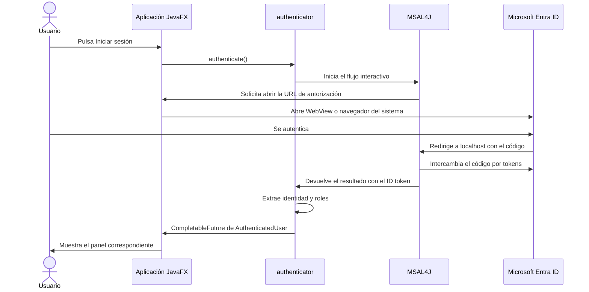

# CRUD2GUI Authenticator

Biblioteca Maven que autentica clientes públicos de escritorio contra Microsoft Entra ID mediante MSAL4J. La interfaz anfitriona proporciona la acción que presenta la autorización; `desktop-app` permite cargarla en un `WebView` JavaFX o abrirla en el navegador del sistema. El flujo interactivo usa authorization code con PKCE y un callback loopback.

Este módulo no es una aplicación ejecutable y no depende directamente de JavaFX. No incluye credenciales de usuario ni `client secret`.

## Cómo funciona

Microsoft Entra ID autentica al usuario; este módulo coordina el proceso mediante MSAL4J y devuelve a la aplicación la identidad y los roles obtenidos. La aplicación anfitriona decide cómo mostrar el navegador y qué hacer con el usuario autenticado.



El flujo utiliza OAuth 2.0 Authorization Code con PKCE y OpenID Connect para obtener información de identidad. PKCE protege el intercambio del código de autorización y es apropiado para clientes públicos de escritorio, que no pueden guardar un secreto de cliente de forma segura. El callback loopback es una dirección de la propia máquina a la que Microsoft redirige el navegador para que MSAL reciba el resultado.

### Responsabilidades

| Clase | Responsabilidad |
|---|---|
| `AuthenticatorConfig` | Carga y valida el identificador de aplicación, el tenant, el callback y los scopes. |
| `EntraIdAuthenticator` | Configura MSAL, inicia el acceso interactivo y proporciona operaciones para el cierre de sesión. |
| `IdTokenClaims` | Decodifica los claims del ID token recibido y los convierte en el modelo de usuario. |
| `AuthenticatedUser` | Representa la identidad y los roles de aplicación sin exponer tokens ni credenciales. |

## 📂 Estructura del módulo

```text
authenticator/
├── pom.xml
├── README.md
├── script/
│   ├── install.sh
│   ├── test.sh
│   └── verify.sh
└── src/
    ├── main/
    │   ├── java/com/crud2gui/authenticator/entraid/
    │   │   ├── AuthenticatedUser.java
    │   │   ├── AuthenticatorConfig.java
    │   │   ├── EntraIdAuthenticator.java
    │   │   └── IdTokenClaims.java
    │   └── resources/templates/
    │       ├── auth_error_page.html
    │       └── auth_success_page.html
    └── test/java/com/crud2gui/authenticator/entraid/
        ├── AuthenticatorConfigTest.java
        ├── AuthPageTemplatesTest.java
        ├── EntraIdAuthenticatorTest.java
        └── IdTokenClaimsTest.java
```

## Configuración de Entra

En el registro de aplicación, configura la plataforma **Mobile and desktop applications** con el redirect URI loopback que vaya a usar la aplicación, por defecto `http://localhost`. Registra los roles de aplicación `alumno` y `docente` y asígnalos a los usuarios en **Enterprise applications > Users and groups**.

El registro debe ser un cliente público; no necesita `client secret`. El WebView integrado puede no admitir todas las opciones de SSO, MFA o Conditional Access del navegador del sistema. Comprueba el flujo con las políticas del tenant.

## Configuración

`AuthenticatorConfig.fromEnvironment()` lee las variables con esta precedencia: entorno del sistema, propiedades Java `-D`, `.env.private` y `.env.public`. Si no se indican scopes o redirect URI, aplica los valores predeterminados.

| Variable | Descripción | Predeterminado |
|---|---|---|
| `AZURE_CLIENT_ID` | Application (client) ID del registro | Obligatoria |
| `AZURE_TENANT_ID` | ID o dominio del tenant | Obligatoria |
| `AZURE_REDIRECT_URI` | Callback HTTP loopback registrado | `http://localhost` |
| `AZURE_SCOPES` | Scopes separados por espacios o comas | `openid profile email` |

El client ID y el tenant ID identifican la aplicación y el tenant; no son secretos. No configures contraseñas de usuario ni un client secret.

La configuración exige client ID, tenant y al menos un scope. El redirect debe usar HTTP y apuntar a loopback (`localhost`, `127.0.0.1` o `::1`), sin credenciales ni fragmento. La autoridad utilizada es `https://login.microsoftonline.com/<tenant>`.

## API

Los tipos de Entra están en `com.crud2gui.authenticator.entraid` y la identidad devuelta es `AuthenticatedUser`.

```java
import com.crud2gui.authenticator.entraid.AuthenticatorConfig;
import com.crud2gui.authenticator.entraid.EntraIdAuthenticator;

AuthenticatorConfig config = AuthenticatorConfig.fromEnvironment();
EntraIdAuthenticator authenticator =
        new EntraIdAuthenticator(config, loginView::showEmbeddedBrowser);

authenticator.authenticate().thenAccept(user -> {
    if (user.isDocente()) {
        // Mostrar funciones de docente.
    } else if (user.isAlumno()) {
        // Mostrar funciones de alumno.
    }
});
```

`OpenBrowserAction` permite que la interfaz anfitriona decida cómo presentar la URL de autorización. `authenticate()` es asíncrono y devuelve `CompletableFuture<AuthenticatedUser>`; no bloquees el hilo de interfaz. `AuthenticatedUser` contiene claims de identidad y roles, no el token. MSAL gestiona la caché de tokens en memoria. Además del constructor de dos argumentos, `EntraIdAuthenticator` admite un mensaje de éxito para la página del callback; `desktop-app` lo elige según `AZURE_AUTH_BROWSER`, variable propia de la aplicación de escritorio (`webview` por defecto, o `system`).

La petición interactiva usa `Prompt.LOGIN` y espera el callback hasta 180 segundos. En `desktop-app`, `LoginController` recibe el resultado asíncrono y traslada las actualizaciones de interfaz al hilo de JavaFX mediante `Platform.runLater`.

### Identidad y roles

`IdTokenClaims` interpreta el payload JSON del ID token y construye `AuthenticatedUser`:

| Campo | Claim de origen |
|---|---|
| `objectId` | `oid`; si falta, `sub` |
| `username` | `preferred_username`, `upn` o `email`, en ese orden |
| `displayName` | `name`; si falta, `username` |
| `tenantId` | `tid` |
| `roles` | `roles` |
| `expiresAt` | `exp` |

El identificador es obligatorio; los demás datos pueden faltar. Los roles se consultan con `hasRole()`, `isAlumno()` o `isDocente()`, sin distinguir mayúsculas y minúsculas.

**Límite de confianza:** `IdTokenClaims` decodifica el payload, pero no verifica la firma del JWT. Debe recibir únicamente el ID token obtenido mediante el flujo de MSAL y no utilizarse para validar tokens arbitrarios. `expiresAt` expone la expiración del token de identidad; el módulo no impone por sí mismo la expiración de la sesión de la aplicación.

Autenticar a un usuario no garantiza que tenga un rol admitido. En `desktop-app`, el rol `docente` abre el panel docente y `alumno` abre el panel de alumno; si tiene ambos, se prioriza `docente`. Si no tiene ninguno, se muestra un aviso y no se abre ninguno de esos paneles.

### Cierre de sesión

`clearAccounts()` elimina las cuentas y tokens de la caché MSAL en memoria. Esto no cierra por sí solo la sesión web de Microsoft. `logoutUri()` construye la URL de cierre de Entra con un retorno a la URI registrada; la aplicación anfitriona debe abrirla. `logoutUri(false)` omite ese retorno.

En `desktop-app`, el navegador integrado espera la redirección de cierre y advierte si falla o se agota el tiempo de espera. Con el navegador del sistema, la aplicación solicita el cierre sin retorno, pero no puede confirmarlo y muestra una advertencia. Si falla la limpieza local, vuelve al acceso sin solicitar el cierre remoto.

### Páginas de resultado

Las páginas locales que MSAL muestra al completar o fallar el callback están en `src/main/resources/templates/auth_success_page.html` y `src/main/resources/templates/auth_error_page.html`. La plantilla de éxito contiene el marcador `{{SUCCESS_MESSAGE}}`, que el autenticador sustituye por el mensaje seleccionado por la interfaz, escapando caracteres HTML. En modo `system` indica volver a CRUD2GUI y cerrar la pestaña; en modo `webview`, que la aplicación continuará. Son páginas de resultado; la página de inicio de sesión sigue alojada por Microsoft.

## Pruebas

```bash
modules/authenticator/script/test.sh
```

Las pruebas son unitarias: no abren el navegador ni autentican contra Entra. El test de claims usa un JWT sintético para comprobar la extracción del payload; la autenticidad del token corresponde a MSAL.